<p align="center">
  <picture>
    <source media="(prefers-color-scheme: dark)" srcset="assets/readme/hero/hero-waybill-dark.svg">
    <source media="(prefers-color-scheme: light)" srcset="assets/readme/hero/hero-waybill-light.svg">
    
  </picture>
</p>

<h1 align="center">Black Marlin Downloader</h1>

<p align="center">
  <b>A download is a delivery.</b><br>
  The desktop download manager you already know — rebuilt from scratch in Rust with dynamic midpoint re-splitting, BitTorrent &amp; uTP, video &amp; gallery relay, and 86 interface languages. Free and open source under GPL-3.0, with zero ads, trials, or telemetry.
</p>

<p align="center">
  <a href="https://github.com/DecoyINDIA/BMD/releases/download/v1.0.0/BMD-1.0.0-setup.exe">
    <picture>
      <source media="(prefers-color-scheme: dark)" srcset="assets/readme/branding/download-cta-dark.svg">
      <source media="(prefers-color-scheme: light)" srcset="assets/readme/branding/download-cta-light.svg">
      
    </picture>
  </a>
</p>

<p align="center">
  <sub>
    <b>Windows x64 Installer (19.0 MiB)</b> ·
    <a href="#download-center-v100">Windows ARM64 / x86 / Portable · Linux (.deb, .rpm, AppImage, Docker) · macOS (Experimental) · Browser Extensions</a> ·
    <a href="https://github.com/DecoyINDIA/BMD/releases">All Releases</a>
  </sub>
</p>

<p align="center">
  <picture>
    <source media="(prefers-color-scheme: dark)" srcset="assets/readme/dividers/waybill-tear-dark.svg">
    <source media="(prefers-color-scheme: light)" srcset="assets/readme/dividers/waybill-tear-light.svg">
    
  </picture>
</p>

## IDM's Window. Rebuilt in Rust.

Losing a connection halfway through a large file shouldn't cost you the first half. **Black Marlin Downloader (`BMD`)** is designed around a straightforward premise from [PRODUCT.md](PRODUCT.md) and [DESIGN.md](DESIGN.md): keep the familiar desktop layout, category tree, queues, Scheduler, Speed Limiter, and progress window that millions of download-manager users already navigate by muscle memory — and replace the entire engine underneath with clean-room Rust (`1.98`, edition `2024`).

| Principle | What It Means in Practice |
| :--- | :--- |
| **Familiar first** | Categories on the left, toolbar across the top, queue and progress windows where you expect them — zero forced learning curve. |
| **Measured, not claimed** | Every speed figure cites reproducible local [`labserver`](crates/labserver) runs against IDM `6.42.25.3` ([`website/bench/results.json`](website/bench/results.json)). |
| **Free means free** | Licensed under [`GPL-3.0-or-later`](LICENSE). No nag screens, no trial countdowns, no sign-up walls, no ads, and no phone-home telemetry. |
| **Honest about limits** | Windows 10/11 and Linux desktop (`x86_64` / `arm64`) are supported and tested; macOS `.dmg` builds are explicitly marked `-experimental`; open gaps stay public on the [Roadmap](ROADMAP.md). |

### Not a reverse-engineering project

BMD is a **clean-room implementation** written from scratch. It contains **zero** code, binaries, artwork, icons, sounds, or text from Internet Download Manager (Tonec) or any other download manager, and never patches or bypasses anyone's licensing. IDM is named strictly as a functional workflow reference and reproducible benchmark baseline. See [ATTRIBUTION.md](ATTRIBUTION.md) for every third-party icon set, font, and dataset bundled or referenced.

---

## Live Product Tour & Interface Gallery

Every screenshot below is captured directly from the unretouched BMD application — no synthetic mockups or painted chrome.

<p align="center">
  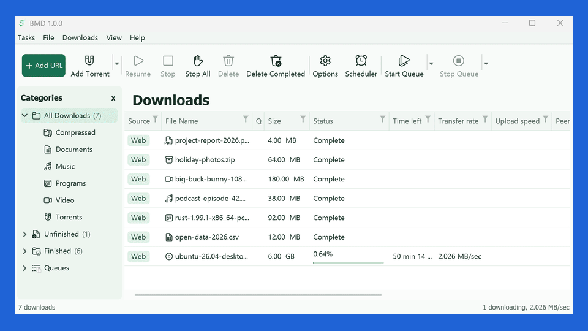
</p>

<p align="center">
  <sub><b>6-Frame Product Tour</b> — Main Window (Light) → Main Window (Dark) → Active Segmented Progress → BitTorrent Pieces → Video Download → Link Grabber</sub>
</p>

### Main Window — Light & Dark Themes

BMD follows your operating system's light or dark preference automatically and ships 10 built-in themes (`Emerald`, `Classic`, `Native`, `High contrast`, `Metro`, `Adwaita`, `Breeze`, `Luna`, `Aero`, `Aqua`) plus custom TOML/Base16/`pywal` palettes.

<p align="center">
  <picture>
    <source media="(prefers-color-scheme: dark)" srcset="assets/readme/screenshots/showcase-main-dark.png">
    <source media="(prefers-color-scheme: light)" srcset="assets/readme/screenshots/showcase-main-light.png">
    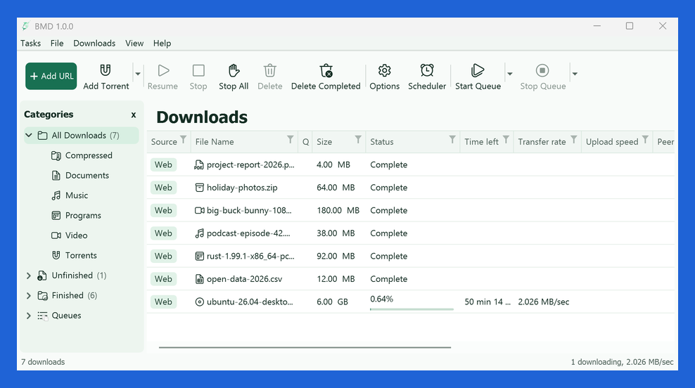
  </picture>
</p>

<details>
<summary><b>Inspect the Dialog Suite (Progress, BitTorrent Pieces, Video Download, Link Grabber / Add Torrent)</b></summary>

<p align="center">
  <picture>
    <source media="(prefers-color-scheme: dark)" srcset="assets/readme/screenshots/showcase-dialogs-dark.png">
    <source media="(prefers-color-scheme: light)" srcset="assets/readme/screenshots/showcase-dialogs-light.png">
    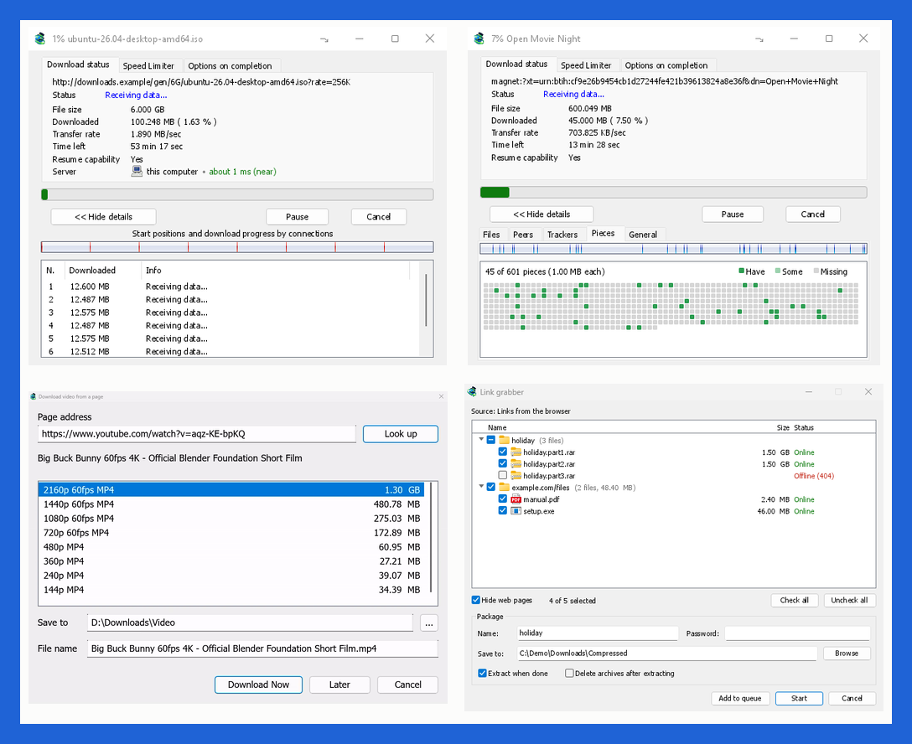
  </picture>
</p>

</details>

### Real Feature Surfaces

<table>
  <tr>
    <td width="52%" valign="top">
      <a href="docs/video.md"></a><br>
      <sub><b>In-Page Video Capture</b> — Pre-fetches stream formats via <code>yt-dlp</code> on hover, offering up to 4K 60fps HDR or <code>Most compatible (H.264 + AAC)</code> with chapter embedding and parallel HLS/DASH chunking.</sub>
    </td>
    <td width="48%" valign="top">
      <a href="docs/torrents.md"></a><br>
      <sub><b>BitTorrent &amp; uTP Swarm Grid</b> — Built on <code>librqbit</code> + <code>librqbit-utp</code> with selective magnet file picking, pre-start rename, DHT, peer filtering, IP blocklists, and live piece-map telemetry.</sub>
    </td>
  </tr>
  <tr>
    <td width="52%" valign="top">
      <a href="docs/languages.md"></a><br>
      <sub><b>First-Class RTL &amp; 86 Languages</b> — Full right-to-left mirroring for Arabic, Hebrew, Persian, Urdu, and Uyghur, while keeping URLs, file paths, and numeric fields readable via Unicode isolation.</sub>
    </td>
    <td width="48%" valign="top" align="center">
      <a href="docs/remote-control.md"></a><br>
      <sub><b>LAN HTTPS Remote Control</b> — Pair phones or browsers via QR code and 8-digit pairing token over local HTTPS (<code>crates/remote</code>) to add links, magnets, or torrents and manage queues without cloud relays.</sub>
    </td>
  </tr>
</table>

<p align="center">
  <picture>
    <source media="(prefers-color-scheme: dark)" srcset="assets/readme/dividers/pulse-rule-dark.svg">
    <source media="(prefers-color-scheme: light)" srcset="assets/readme/dividers/pulse-rule-light.svg">
    
  </picture>
</p>

## How the Adaptive Segment Engine Works

<p align="center">
  <picture>
    <source media="(prefers-color-scheme: dark)" srcset="assets/readme/animations/segment-engine-dark.svg">
    <source media="(prefers-color-scheme: light)" srcset="assets/readme/animations/segment-engine-light.svg">
    
  </picture>
</p>

Inside [`crates/engine`](crates/engine), every HTTP(S) and FTP(S) transfer moves through a deterministic, crash-safe pipeline decoupled completely from the UI:

1. **`probe()` & Site Resolvers:** Inspects `Content-Length`, `Accept-Ranges: bytes`, `ETag`, `Last-Modified`, and redirect chains (`sites/gdrive.rs`, `sites/mediafire.rs`, `sites/rapidgator.rs`, plus expired-link refresh), while `HostLimits` records per-host concurrency ceilings.
2. **Dynamic Midpoint Re-Splitting (`planner.rs`):** Launches parallel HTTP/1.1 connections (up to 128 configured, 8 by default) or pooled FTP/FTPS (`REST` + `RETR`) sessions. Whenever a worker finishes its byte range, the planner splits the **largest remaining active segment in half** so fast lanes help slower ones reach the tail together.
3. **Slow-Worker Drop & Reclaim:** Each worker's rate is compared against the active line share; stalled or crawling connections are dropped cleanly and their remaining range is re-split across healthy workers.
4. **Sparse `.bmd.part` + `craft-atomic` Resume:** Workers write directly at their byte offsets into `<filename>.bmd.part` (allocated sparse) while the segment table is committed atomically to `.bmd.json` via `craft-atomic`. Interrupted transfers survive crashes or power cuts without re-downloading completed bytes.
5. **Browser-Grade TLS Fallback:** When strict servers or anti-bot checks reject standard client handshakes (such as `412` or TLS/HTTP2 fingerprinting), the engine retries via **BoringSSL** using your browser's TLS handshake, HTTP/2 settings, header order, and site cookies (without solving CAPTCHAs).

---

## Measured Performance (Not Claimed)

<p align="center">
  <picture>
    <source media="(prefers-color-scheme: dark)" srcset="assets/readme/animations/benchmark-race-dark.svg">
    <source media="(prefers-color-scheme: light)" srcset="assets/readme/animations/benchmark-race-light.svg">
    
  </picture>
</p>

### Reproducible Benchmark Matrix (`labserver` vs IDM 6.42.25.3)

Recorded on **2026-10-29** (`website/bench/results.json`, status `final`) on Windows 11 (`10.0.26200`), Intel Core i5-13400F, 63.8 GiB RAM, destination on local `C:`, against BMD's built-in fault-injecting [`bmd-labserver`](crates/labserver) (`127.0.0.1:8097`). Both clients ran at **default settings (8 connections)** across **7 alternating runs per scenario** (0 failures); values below are end-to-end medians (`e2e_ms`) from commit `caa200c`.

| Scenario ID | Condition | IDM `6.42.25.3` Median | BMD (`caa200c`) Median | Speedup |
| :--- | :--- | ---: | ---: | ---: |
| `fast-1g` | 1 GiB over a fast local link | `5,456.38 ms` | `1,009.35 ms` | **5.41×** |
| `small-256k` | 256 KiB file over a fast local link | `3,140.92 ms` | `29.66 ms` | **105.90×** |
| `drops-50m` | 50 MiB, every 2nd connection cut after 2 MiB (`4 MB/s`) | `5,427.68 ms` | `1,646.52 ms` | **3.30×** |
| `slowconn-32m` | 32 MiB, 1 in 3 connections crawls at `128 KB/s` | `7,212.96 ms` | `3,432.05 ms` | **2.10×** |
| `latency-100m` | 100 MiB, `150 ms` latency, `4 MB/s` per connection | `7,621.91 ms` | `3,843.75 ms` | **1.98×** |
| `capped-100m` | 100 MiB, `2 MB/s` per connection | `10,234.05 ms` | `6,319.47 ms` | **1.62×** |
| `maxconns-50m` | 50 MiB, server allows 2 connections (`2 MB/s` each) | `15,864.21 ms` | `12,567.65 ms` | **1.26×** |

Reproduce fault-injection scenarios locally with `cargo run -p bmd-labserver -- --faults "rate=2M"`.

<p align="center">
  <picture>
    <source media="(prefers-color-scheme: dark)" srcset="assets/readme/dividers/waybill-tear-dark.svg">
    <source media="(prefers-color-scheme: light)" srcset="assets/readme/dividers/waybill-tear-light.svg">
    
  </picture>
</p>

## Capability Packing List

<p align="center">
  <picture>
    <source media="(prefers-color-scheme: dark)" srcset="assets/readme/features/feature-matrix-dark.svg">
    <source media="(prefers-color-scheme: light)" srcset="assets/readme/features/feature-matrix-light.svg">
    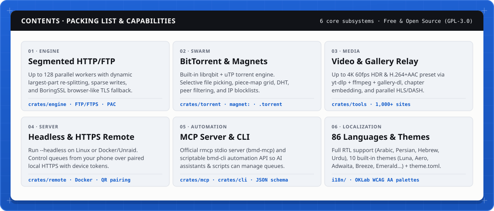
  </picture>
</p>

- **Segmented HTTP/HTTPS & FTP/FTPS (`bmd-engine`):** Dynamic midpoint re-splitting, per-download and global token-bucket speed limiters, PAC proxy scripts, SOCKS/HTTP proxies, offline server geolocation via DB-IP Lite + 250-flag atlas (`bmd-geo`), and SHA/MD5/CRC32 verification.
- **BitTorrent & Magnets (`bmd-torrent`):** Built-in `librqbit` + `librqbit-utp` (TCP & UDP/uTP), selective file downloads, pre-start single-file or folder rename, DHT, peer filtering, IP blocklists, upload speed & share ratio columns.
- **Video & Gallery Relay (`bmd-tools`):** Verified `yt-dlp`, `ffmpeg`, and `gallery-dl` integration across 1,000+ sites, up to 4K 60fps HDR, `Most compatible (H.264 + AAC)` MP4 preset, embedded chapters, subtitles, playlists, and multi-connection HLS/DASH chunk downloading.
- **Debrid, Link Grabber & Archives (`bmd-debrid`, `bmd-cnl`, `bmd-extract`):** Experimental Real-Debrid, AllDebrid, Premiumize, TorBox, and Mega-Debrid resolvers; Click'n'Load 2 listener (`127.0.0.1:9666`); clipboard batch extraction; keychain-saved archive passwords; in-process `zip`/`tar`/`gz`/`xz`, external 7-Zip (`7z`/`RAR`), and [HatchZip](https://hatchzip.dev) extract-in-place.
- **Headless Server & Local HTTPS Remote (`bmd-remote`):** Run `bmd --headless` on Linux, NAS, Docker, or Unraid (`docker/compose.yml`, `docker/unraid.xml`) and pair any phone or browser via QR code + self-signed cert fingerprint.
- **CLI & AI Assistant MCP (`bmd-cli`, `bmd-mcp`):** Familiar IDM switches (`/d /p /f /a /n /s`), scriptable `bmd-cli` (`add`, `video-get`, `playlist-get`, `start-queue`, `stop-queue`, `pair`), and an official stdio MCP server exposing `list_downloads`, `add_download`, `pause_downloads`, `resume_downloads`, `remove_downloads`, `start_queue`, and `stop_queue`.

---

## Browser-to-Engine Capture Workflow

<p align="center">
  <picture>
    <source media="(prefers-color-scheme: dark)" srcset="assets/readme/animations/workflow-capture-dark.svg">
    <source media="(prefers-color-scheme: light)" srcset="assets/readme/animations/workflow-capture-light.svg">
    
  </picture>
</p>

1. **`extension/` (Chromium MV3 & Firefox):** Works in Chrome, Edge, Brave, Opera, Vivaldi, Helium, Comet, Firefox 140+, Zen, LibreWolf, Floorp, Waterfox, and Safari 17+ (macOS experimental). Hands off download URLs along with referrer, User-Agent, site cookies, and optional browser-proxy/VPN routing — plus **Media on this page** and the draggable **Download video** button.
2. **`bmd-nmhost` (`crates/nmhost`):** Native messaging host (`com.blackmarlindownloader.host`) that validates capture rules and streams bulk link grabs in 1 MiB `LinksPart` frames.
3. **`bmd-ipc` (`crates/ipc`):** Token-protected local socket (`127.0.0.1`) ensuring single-instance dispatch with zero duplicate window launches.
4. **Dispatch Target (`bmd-app` / `bmd-remote` / `bmd-mcp`):** Queues jobs into the desktop window or headless server, or lets the browser keep any download you `Alt`-click or decline. See [Browser integration](docs/browser-integration.md).

<p align="center">
  <picture>
    <source media="(prefers-color-scheme: dark)" srcset="assets/readme/dividers/pulse-rule-dark.svg">
    <source media="(prefers-color-scheme: light)" srcset="assets/readme/dividers/pulse-rule-light.svg">
    
  </picture>
</p>

## 15-Crate Workspace Architecture

<p align="center">
  <picture>
    <source media="(prefers-color-scheme: dark)" srcset="assets/readme/illustrations/architecture-map-dark.svg">
    <source media="(prefers-color-scheme: light)" srcset="assets/readme/illustrations/architecture-map-light.svg">
    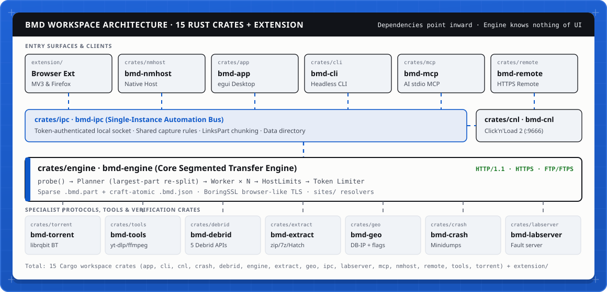
  </picture>
</p>

Dependencies point inward: entry surfaces (`bmd-app`, `bmd-cli`, `bmd-mcp`, `bmd-nmhost`, `bmd-remote`) talk through `bmd-ipc` to `bmd-engine`, which knows nothing about the GUI. Portable crates enforce `unsafe_code = "deny"`, isolating OS integration to `crates/app/src/win32.rs` and `unix.rs`. Full design notes live in [docs/ARCHITECTURE.md](docs/ARCHITECTURE.md).

<details>
<summary><b>Complete 15-Crate Workspace Manifest</b></summary>

| Crate | Path | Binary / Role |
| :--- | :--- | :--- |
| `bmd-app` | [`crates/app`](crates/app) | `bmd` — `egui` desktop UI, main list, categories, queues, Scheduler, themes, tray |
| `bmd-engine` | [`crates/engine`](crates/engine) | Core segmented HTTP(S)/FTP(S) engine, planner, BoringSSL browser TLS, resume |
| `bmd-cli` | [`crates/cli`](crates/cli) | `bmd-cli` — headless `get`/`resume`/`video-get` and automation API commands |
| `bmd-mcp` | [`crates/mcp`](crates/mcp) | `bmd-mcp` — stdio Model Context Protocol server for AI assistants |
| `bmd-nmhost` | [`crates/nmhost`](crates/nmhost) | `bmd-nmhost` — browser native messaging host (`com.blackmarlindownloader.host`) |
| `bmd-ipc` | [`crates/ipc`](crates/ipc) | Token-protected `127.0.0.1` single-instance channel and shared capture rules |
| `bmd-remote` | [`crates/remote`](crates/remote) | Local-network HTTPS server, QR pairing, device tokens, and mobile web UI |
| `bmd-torrent` | [`crates/torrent`](crates/torrent) | BitTorrent & magnet downloads via `librqbit` + `librqbit-utp` |
| `bmd-tools` | [`crates/tools`](crates/tools) | Pinned & signature-verified `yt-dlp`, `ffmpeg`, `gallery-dl`, and app updater |
| `bmd-debrid` | [`crates/debrid`](crates/debrid) | Real-Debrid, AllDebrid, Premiumize, TorBox, and Mega-Debrid API clients |
| `bmd-cnl` | [`crates/cnl`](crates/cnl) | Click'n'Load 2 local listener (`127.0.0.1:9666`) feeding Link grabber |
| `bmd-extract` | [`crates/extract`](crates/extract) | In-process `zip`/`tar`/`gz`/`xz`; external 7-Zip (`7z`/`RAR`) & HatchZip |
| `bmd-geo` | [`crates/geo`](crates/geo) | Offline DB-IP IP-to-Country Lite lookup + 250-flag atlas |
| `bmd-crash` | [`crates/crash`](crates/crash) | Out-of-process crash/freeze watchdog, minidumps, and symbolicated stack traces |
| `bmd-labserver` | [`crates/labserver`](crates/labserver) | `labserver` — HTTP Range & FTP/FTPS fault-injection test/benchmark server |

</details>

<p align="center">
  <picture>
    <source media="(prefers-color-scheme: dark)" srcset="assets/readme/dividers/waybill-tear-dark.svg">
    <source media="(prefers-color-scheme: light)" srcset="assets/readme/dividers/waybill-tear-light.svg">
    
  </picture>
</p>

## Download Center (v1.0.0)

Published **2026-11-19** · [Release Notes (`v1.0.0`)](https://github.com/DecoyINDIA/BMD/releases/tag/v1.0.0) · [All Releases](https://github.com/DecoyINDIA/BMD/releases)

### Windows (Windows 10 / 11)

| Architecture | Installer (Recommended) | Portable Zip (`data/` beside exe) | Raw Zip (`%APPDATA%\bmd`) |
| :--- | :--- | :--- | :--- |
| **x64** (Intel / AMD) | [`BMD-1.0.0-setup.exe`](https://github.com/DecoyINDIA/BMD/releases/download/v1.0.0/BMD-1.0.0-setup.exe) (`19.0 MiB`) | [`BMD-1.0.0-portable.zip`](https://github.com/DecoyINDIA/BMD/releases/download/v1.0.0/BMD-1.0.0-portable.zip) (`23.5 MiB`) | [`BMD-1.0.0-x64.zip`](https://github.com/DecoyINDIA/BMD/releases/download/v1.0.0/BMD-1.0.0-x64.zip) (`23.5 MiB`) |
| **ARM64** (Snapdragon) | [`BMD-1.0.0-setup-arm64.exe`](https://github.com/DecoyINDIA/BMD/releases/download/v1.0.0/BMD-1.0.0-setup-arm64.exe) (`17.9 MiB`) | [`BMD-1.0.0-portable-arm64.zip`](https://github.com/DecoyINDIA/BMD/releases/download/v1.0.0/BMD-1.0.0-portable-arm64.zip) (`22.2 MiB`) | [`BMD-1.0.0-arm64.zip`](https://github.com/DecoyINDIA/BMD/releases/download/v1.0.0/BMD-1.0.0-arm64.zip) (`22.2 MiB`) |
| **x86** (32-bit Win 10) | [`BMD-1.0.0-setup-x86.exe`](https://github.com/DecoyINDIA/BMD/releases/download/v1.0.0/BMD-1.0.0-setup-x86.exe) (`18.4 MiB`) | [`BMD-1.0.0-portable-x86.zip`](https://github.com/DecoyINDIA/BMD/releases/download/v1.0.0/BMD-1.0.0-portable-x86.zip) (`22.2 MiB`) | [`BMD-1.0.0-x86.zip`](https://github.com/DecoyINDIA/BMD/releases/download/v1.0.0/BMD-1.0.0-x86.zip) (`22.2 MiB`) |

### Linux (`glibc >= 2.35`) & Docker

Tested on Ubuntu 24.04, Debian 12, and Fedora (GNOME, KDE Plasma, Xfce, Cinnamon on X11 and Wayland/XWayland).

| Architecture | Debian / Ubuntu (`.deb`) | Fedora / RHEL (`.rpm`) | Universal (`AppImage`) | Plain Archive (`.tar.gz`) |
| :--- | :--- | :--- | :--- | :--- |
| **`x86_64`** | [`BMD-1.0.0-linux-x86_64.deb`](https://github.com/DecoyINDIA/BMD/releases/download/v1.0.0/BMD-1.0.0-linux-x86_64.deb) (`19.5 MiB`) | [`BMD-1.0.0-linux-x86_64.rpm`](https://github.com/DecoyINDIA/BMD/releases/download/v1.0.0/BMD-1.0.0-linux-x86_64.rpm) (`23.6 MiB`) | [`BMD-1.0.0-linux-x86_64.AppImage`](https://github.com/DecoyINDIA/BMD/releases/download/v1.0.0/BMD-1.0.0-linux-x86_64.AppImage) (`22.9 MiB`) | [`BMD-1.0.0-linux-x86_64.tar.gz`](https://github.com/DecoyINDIA/BMD/releases/download/v1.0.0/BMD-1.0.0-linux-x86_64.tar.gz) (`23.7 MiB`) |
| **`arm64`** | [`BMD-1.0.0-linux-arm64.deb`](https://github.com/DecoyINDIA/BMD/releases/download/v1.0.0/BMD-1.0.0-linux-arm64.deb) (`18.7 MiB`) | [`BMD-1.0.0-linux-arm64.rpm`](https://github.com/DecoyINDIA/BMD/releases/download/v1.0.0/BMD-1.0.0-linux-arm64.rpm) (`22.4 MiB`) | [`BMD-1.0.0-linux-arm64.AppImage`](https://github.com/DecoyINDIA/BMD/releases/download/v1.0.0/BMD-1.0.0-linux-arm64.AppImage) (`21.8 MiB`) | [`BMD-1.0.0-linux-arm64.tar.gz`](https://github.com/DecoyINDIA/BMD/releases/download/v1.0.0/BMD-1.0.0-linux-arm64.tar.gz) (`22.4 MiB`) |

- **Docker / Unraid Headless Server:** Pull `ghcr.io/decoyindia/bmd:latest` (or `:v1.0.0`) or deploy with [`docker/compose.yml`](docker/compose.yml) / [`docker/unraid.xml`](docker/unraid.xml). See [Run BMD on a server](docs/server.md).

### macOS (Experimental) & Browser Extensions

| Target | Package | Size | Notes |
| :--- | :--- | ---: | :--- |
| **macOS Apple Silicon (`arm64`)** | [`BMD-1.0.0-macos-arm64-experimental.dmg`](https://github.com/DecoyINDIA/BMD/releases/download/v1.0.0/BMD-1.0.0-macos-arm64-experimental.dmg) | `17.3 MiB` | Experimental, unnotarized — see [On a Mac](docs/getting-started.md#on-a-mac) |
| **macOS Intel (`x86_64`)** | [`BMD-1.0.0-macos-x86_64-experimental.dmg`](https://github.com/DecoyINDIA/BMD/releases/download/v1.0.0/BMD-1.0.0-macos-x86_64-experimental.dmg) | `19.0 MiB` | Experimental, unnotarized — right-click → **Open** on first run |
| **Chromium MV3 (Unpacked)** | [`BMD-1.0.0-extension-chromium.zip`](https://github.com/DecoyINDIA/BMD/releases/download/v1.0.0/BMD-1.0.0-extension-chromium.zip) | `260.9 KiB` | Chrome, Edge, Brave, Opera, Vivaldi, Helium, Comet |
| **Chrome Web Store Bundle** | [`BMD-1.0.0-chrome-web-store.zip`](https://github.com/DecoyINDIA/BMD/releases/download/v1.0.0/BMD-1.0.0-chrome-web-store.zip) | `260.6 KiB` | Store-packaged Chromium MV3 archive |
| **Firefox (`140+`) Add-on** | [`BMD-1.0.0-extension-firefox.xpi`](https://github.com/DecoyINDIA/BMD/releases/download/v1.0.0/BMD-1.0.0-extension-firefox.xpi) | `263.1 KiB` | Firefox, Zen, LibreWolf, Floorp, Waterfox |

### Verification & Provenance

Every release artifact ships with a unified SHA-256 manifest and keyless Sigstore GitHub build provenance attestation:

- **Checksums:** [`SHA256SUMS.txt`](https://github.com/DecoyINDIA/BMD/releases/download/v1.0.0/SHA256SUMS.txt) (`3.3 KiB`)
- **Sigstore Provenance:** `gh attestation verify <downloaded-file> --repo DecoyINDIA/BMD`

---

## Live Download Telemetry & Repository Pulse

<p align="center">
  <picture>
    <source media="(prefers-color-scheme: dark)" srcset="assets/readme/analytics/telemetry-dashboard-dark.svg">
    <source media="(prefers-color-scheme: light)" srcset="assets/readme/analytics/telemetry-dashboard-light.svg">
    
  </picture>
</p>

<p align="center">
  <picture>
    <source media="(prefers-color-scheme: dark)" srcset="assets/readme/analytics/platform-breakdown-dark.svg">
    <source media="(prefers-color-scheme: light)" srcset="assets/readme/analytics/platform-breakdown-light.svg">
    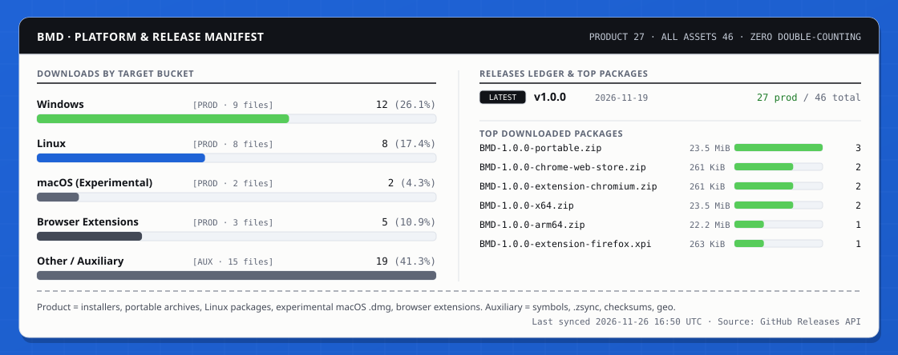
  </picture>
</p>

- **Update Cadence:** Periodically refreshed every **6 hours** via [`.github/workflows/readme-analytics.yml`](.github/workflows/readme-analytics.yml) against the GitHub Releases & Repository API, stored in [`data/analytics/downloads.json`](data/analytics/downloads.json).
- **Zero Double-Counting Policy:** **27 product & extension downloads** (installers, portable archives, Linux packages, experimental macOS `.dmg`, browser extensions) are tracked separately from **19 auxiliary assets** (debug symbols, `.zsync` delta files, `SHA256SUMS.txt`, license/geo data) = **46 total release assets**.
- **Tracking Start Date:** Historical snapshot tracking began on **`2026-11-26`** — no synthetic or backfilled history is generated prior to that date, and `24h` / `7d` / `30d` deltas appear only once real snapshots span those windows.

<details>
<summary><b>Static Fallback Chart &amp; Accessible Telemetry Table</b></summary>

<p align="center">
  <picture>
    <source media="(prefers-color-scheme: dark)" srcset="assets/readme/analytics/telemetry-dashboard-static-dark.svg">
    <source media="(prefers-color-scheme: light)" srcset="assets/readme/analytics/telemetry-dashboard-static-light.svg">
    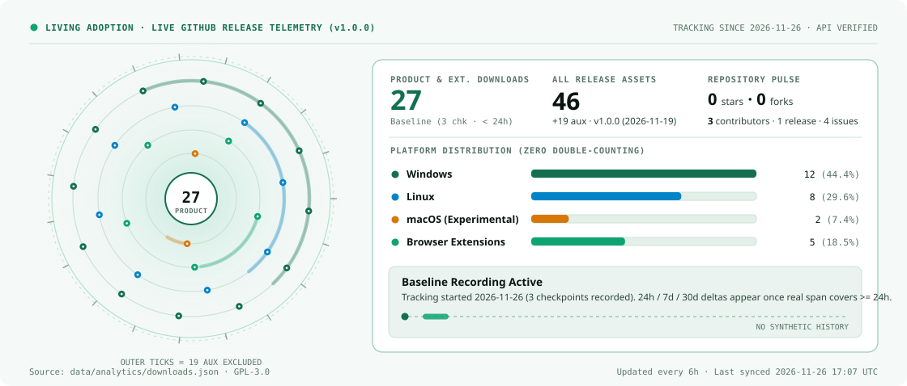
  </picture>
</p>

<!-- BMD:ANALYTICS-TEXT:START -->
| Metric | Value |
| :--- | :--- |
| **Product & Extension Downloads** | **27** |
| **All Release Assets Total** (incl. symbols, `.zsync`, checksums, geo) | 46 |
| **Latest Release** | `v1.0.0` (27 product downloads · 2026-11-19) |
| **Repository Pulse** | 0 stars · 0 forks · 3 contributors |
| **Tracking Started** | `2026-11-26 16:20 UTC` |
| **Last Synced** | `2026-11-26 16:20 UTC` · `api_status`: `ok (live GitHub API)` |

| Platform Bucket | Category | Downloads | Share (Product) | Share (All Assets) |
| :--- | :--- | ---: | ---: | ---: |
| Windows | Product | 12 | 44.4% | 26.1% |
| Linux | Product | 8 | 29.6% | 17.4% |
| macOS (Experimental) | Product | 2 | 7.4% | 4.3% |
| Browser Extensions | Product | 5 | 18.5% | 10.9% |
| Other / Auxiliary | Auxiliary | 19 | — | 41.3% |
<!-- BMD:ANALYTICS-TEXT:END -->

</details>

<p align="center">
  <picture>
    <source media="(prefers-color-scheme: dark)" srcset="assets/readme/dividers/pulse-rule-dark.svg">
    <source media="(prefers-color-scheme: light)" srcset="assets/readme/dividers/pulse-rule-light.svg">
    
  </picture>
</p>

## Platform & Language Matrix

### Target Environments

| Platform | Architectures & Packaging | Status & Requirements |
| :--- | :--- | :--- |
| **Windows 10 / 11** | `x64`, `arm64` (Snapdragon), 32-bit `x86` (`setup.exe`, `portable.zip`, raw `.zip`) | **Supported** — Direct3D 12 default (OpenGL/WARP fallback on older GPUs); 32-bit uses OpenGL + user-supplied `ffmpeg` |
| **Linux Desktop** | `x86_64`, `arm64` (`.deb`, `.rpm`, `AppImage`, `.tar.gz`) | **Supported** — `glibc >= 2.35`; tested on GNOME, KDE Plasma, Xfce, and Cinnamon (X11 & Wayland/XWayland) |
| **Docker / Headless** | `ghcr.io/decoyindia/bmd:latest` (`--headless`, Compose, Unraid) | **Supported** — ~175 MiB slim Debian runtime, zero desktop libraries, LAN HTTPS remote (`:8463`) |
| **macOS** | `arm64` (Apple Silicon), `x86_64` (Intel) `.dmg` | **Experimental** — unnotarized builds with bundled Safari 17+ extension; feedback welcome in Issues |

### 86 Interface Languages & Custom Themes

<table>
  <tr>
    <td width="64%" valign="top">
      <ul>
        <li><b>86 UI Languages (<a href="i18n/languages.tsv"><code>i18n/languages.tsv</code></a>):</b> Every Windows 11 display language — Afrikaans to Vietnamese, including Simplified/Traditional Chinese, regional Spanish/French/Portuguese, and Serbian Cyrillic/Latin.</li>
        <li><b>Right-to-Left Layouts:</b> Complete mirroring in Arabic, Hebrew, Persian, Urdu, and Uyghur with proper bidi isolation for URLs and file paths (<a href="docs/languages.md">Languages guide</a>).</li>
        <li><b>Locale-Aware Formatting:</b> Regional digit grouping, decimal marks, and 12/24-hour clocks via <b>Options → Regional</b>.</li>
        <li><b>OKLab &amp; TOML Theme Engine:</b> 10 built-in looks plus drop-in <code>theme.toml</code> / <code>.json</code>, Base16 YAML, and live <code>pywal</code> wallust schemes verified to WCAG AA contrast (<a href="docs/themes.md">Themes guide</a>).</li>
      </ul>
    </td>
    <td width="36%" align="center" valign="middle">
      <a href="docs/languages.md"></a>
    </td>
  </tr>
</table>

---

## Release Timeline & Roadmap

| Release | Date | Key Milestones |
| :--- | :--- | :--- |
| **`0.1.0`** | `2026-10-30` | Initial clean-room Rust release — 32-connection adaptive engine, FTP/FTPS, queues & Scheduler, 86 languages, BitTorrent (`librqbit`), `yt-dlp` video capture, `bmd-cli`. |
| **`0.5.0` → `0.5.2`** | `2026-11-08` – `2026-11-09` | Theme engine (TOML/JSON, Base16, `pywal`), `--headless` server & LAN HTTPS remote, store-ready browser extensions (Chrome Web Store, Firefox, Safari), `gallery-dl` & playlists, selective torrent files & ratio columns. |
| **`1.0.0`** | `2026-11-19` | First release as **Black Marlin Downloader (`BMD`)** — Windows ARM64 & x86, Linux ARM64, H.264+AAC preset, `bmd-mcp` AI server, `bmd-cli add` & queue control, BoringSSL browser TLS & parallel HLS/DASH, Click'n'Load 2, TorBox & Mega-Debrid, Windows drag-out, Sigstore provenance. |
| **`[Unreleased]`** | Active | Built-in **IBM Plex Sans**, **IBM Plex Mono**, and **Space Grotesk** typography across desktop, extension, and remote UI. |

### Upcoming Focus ([`ROADMAP.md`](ROADMAP.md))

- **Linux Desktop Polish:** Orca screen-reader accessibility, Flatpak browser integration checks, native Wayland popup placement (`eframe`), and Vulkan GPU renderer promotion.
- **macOS & Safari:** Developer ID signing for the Safari extension and Metal renderer validation.
- **Additional Benchmarks:** Expanded reproducible comparisons against other download managers ([`CHANGELOG.md`](CHANGELOG.md) · [`ROADMAP.md`](ROADMAP.md)).

<p align="center">
  <picture>
    <source media="(prefers-color-scheme: dark)" srcset="assets/readme/dividers/waybill-tear-dark.svg">
    <source media="(prefers-color-scheme: light)" srcset="assets/readme/dividers/waybill-tear-light.svg">
    
  </picture>
</p>

## Community, Contributors & Documentation

BMD credits everyone who contributes code, native translation reviews, bug reports, and ideas.

<p align="center">
  <a href="https://github.com/adixxdev"></a>
  <a href="https://github.com/awesomeironman"></a>
  <a href="https://github.com/azureknigh7"></a>
  <a href="https://github.com/crse"></a>
  <a href="https://github.com/dhrubo11"></a>
  <a href="https://github.com/dr-strange15"></a>
  <a href="https://github.com/drigva"></a>
  <a href="https://github.com/enderdobra"></a>
  <a href="https://github.com/farjanatech"></a>
  <a href="https://github.com/gowzee"></a>
  <a href="https://github.com/husnainahmedrana"></a>
  <a href="https://github.com/justnxhom"></a>
  <a href="https://github.com/maldo-0750"></a>
  <a href="https://github.com/mayankmohan1992"></a>
  <a href="https://github.com/mfat"></a>
  <a href="https://github.com/mpsp4321"></a>
  <a href="https://github.com/osunday"></a>
  <a href="https://github.com/praveenkumar2k06"></a>
  <a href="https://github.com/sadatdaniel"></a>
  <a href="https://github.com/shreeramncity"></a>
  <a href="https://github.com/shurmanizer"></a>
  <a href="https://github.com/specailm5"></a>
  <a href="https://github.com/stark-0505"></a>
  <a href="https://github.com/swiftypop"></a>
  <a href="https://github.com/twig6943"></a>
  <a href="https://github.com/uyaii"></a>
  <a href="https://github.com/volcanify"></a>
  <a href="https://github.com/zekidt"></a>
</p>

| Guide & Reference | Purpose |
| :--- | :--- |
| [**User Guide Index**](docs/README.md) | Tutorials, [Getting Started](docs/getting-started.md), [Browser Integration](docs/browser-integration.md), [Command Line](docs/command-line.md), [MCP AI Assistants](docs/ai-assistants.md) |
| [**Architecture & Design**](docs/ARCHITECTURE.md) | Crate boundaries, engine planner, font & theme system ([PRODUCT.md](PRODUCT.md) · [DESIGN.md](DESIGN.md)) |
| [**Contributing**](CONTRIBUTING.md) | Clean-room rules, local test harness, translation workflow, and fuzzing targets |
| [**Security Policy**](SECURITY.md) | Private vulnerability advisories, `bmd-nmhost` / `bmd-ipc` trust boundaries, helper signature checks |
| [**Attribution & License**](ATTRIBUTION.md) | Third-party icons, DB-IP Lite dataset, SIL OFL fonts, and [`GPL-3.0-or-later`](LICENSE) terms |

---

## Build from Source & Quality Gates

Requires **Rust `1.98+`** (edition `2024`), **CMake**, **LLVM (`libclang`)**, and **NASM** on Windows (for BoringSSL):

```sh
cargo build
cargo run -p bmd-app
```

Before opening a pull request, run the full workspace verification suite (plus optional libFuzzer parser targets in `fuzz/`):

```sh
cargo fmt --all --check
cargo clippy --workspace --all-targets -- -D warnings
cargo test --workspace
python tools/i18n/extract.py
node tools/extension/test.mjs
```

---

<p align="center">
  <picture>
    <source media="(prefers-color-scheme: dark)" srcset="assets/readme/branding/closing-waybill-dark.svg">
    <source media="(prefers-color-scheme: light)" srcset="assets/readme/branding/closing-waybill-light.svg">
    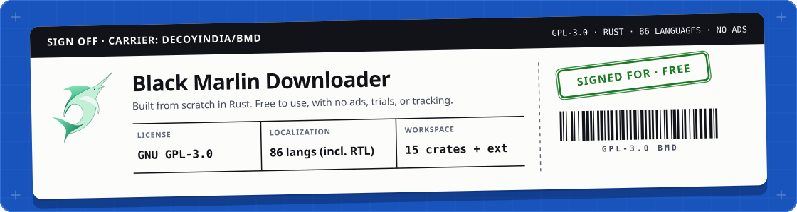
  </picture>
</p>
