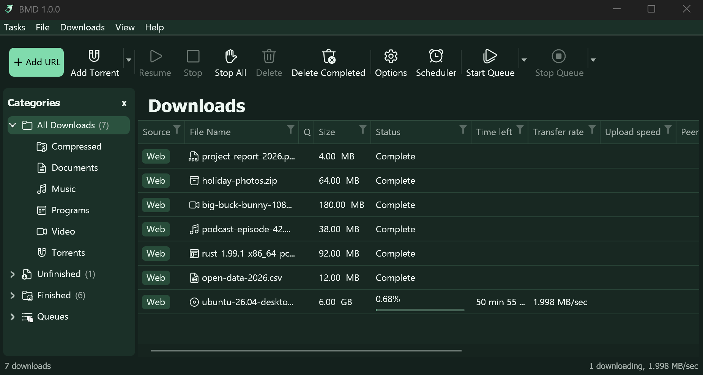

  

  <a href="https://github.com/DecoyINDIA/BMD/releases/download/v1.0.0/BMD-1.0.0-setup.exe"><b>⬇ Try our application: download the Windows installer</b></a> 
  One file: download it, open it, and BMD installs. Other systems and files: <a href="https://github.com/DecoyINDIA/BMD/releases">all releases</a>.

# Black Marlin Downloader

Losing your connection halfway through a big download shouldn't cost you the first half. With Black Marlin, you can pick up where you left off when the server supports resume. You can also queue your next few files and let them run while you sleep.

**[Download Black Marlin for Windows or Linux](https://github.com/DecoyINDIA/BMD/releases)**

Free and open source. No ads, trials, or sign-up. Experimental macOS builds are available on the same releases page.

## Native Android

The Android source is in [`android/`](android/): a Kotlin/Jetpack Compose interface with the Rust download engine behind JNI. It requires Android 8.0 (API 26) or later and supports direct HTTP and HTTPS file links, explicit Paste or Android sharing, pause/resume, optional expected SHA-256 verification, and saving through MediaStore or a folder selected in Android's picker. Transfers, Files and Settings work without a Black Marlin account.

Android has its own scope: desktop browser extensions, torrents, video extraction, FTP, scheduled queues and account sync are not part of this application. A saved file and a transfer-history entry have separate removal controls; a failed save can reuse the retained download.

Read the [build, test and release instructions](docs/android/BUILD_AND_RELEASE.md), [screen and flow design](docs/android/DESIGN.md), and [Android privacy description](docs/android/PRIVACY.md). Build and device results must be checked for the exact revision being distributed; this source tree does not imply an existing Google Play release.

## Screenshots

### Light theme

### Dark theme

## Make room for the way you work

- **Get large files sooner.** Black Marlin can fetch several parts of a file at once when the server supports it. That helps you use more of the bandwidth you already have.
- **Keep your call running smoothly.** Set a speed limit while you're on a video call, or schedule the whole queue for after work.
- **Send a file straight from your browser.** The browser extension hands the download to Black Marlin so you can close the tab and carry on.
- **Pick the files you want from a torrent.** Open a magnet link, select what you need, and follow its progress alongside your other downloads.

The [user guide](docs/README.md) walks you through your first download, browser setup, and scheduling.

## Get involved

You can [build Black Marlin from source](CONTRIBUTING.md#getting-set-up), [report a problem](https://github.com/DecoyINDIA/BMD/issues/new/choose), or [see what's on the roadmap](ROADMAP.md).
