# iDM

iDM is a free, open-source download manager maintained by DecoyINDIA. It runs on Windows and Linux, with experimental macOS support.

## Features

- Split downloads across multiple connections and resume interrupted transfers.
- Organize downloads into queues and schedule when they run.
- Send downloads from your browser to iDM.
- Open magnet links and download files with BitTorrent.

## App preview

<picture>
  <source media="(prefers-color-scheme: dark)" srcset="docs/images/main-dark.webp">
  
</picture>

## Get started

Check [GitHub Releases](https://github.com/DecoyINDIA/iDM/releases) for packaged builds. You can also [build iDM from source](CONTRIBUTING.md#getting-set-up). The [user guide](docs/README.md) covers installation, browser integration, scheduling, and troubleshooting.

Report bugs through [Issues](https://github.com/DecoyINDIA/iDM/issues). Use the [security policy](SECURITY.md) for private vulnerability reports.

## License and credits

iDM is based on [Mister Download Manager](https://github.com/anefzaoui/misterdownloadmanager) by Ahmed Nefzaoui and contributors. DecoyINDIA modified the project on 2026-11-19 to add iDM branding and use its own repository for releases and support.

Copyright (c) 2026 Ahmed Nefzaoui. iDM is available under the [GNU General Public License, version 3](LICENSE) or any later version. See [ATTRIBUTION.md](ATTRIBUTION.md) for third-party credits.

## Not a reverse-engineering project

iDM uses the open-source implementation inherited from Mister Download Manager. It contains no code, binaries, artwork, or text from Internet Download Manager.
