<!-- CHAPTER 01: VELOCITY IN MOTION -->
<p align="center">
  <picture>
    <source media="(prefers-color-scheme: dark)" srcset="assets/readme/hero/hero-velocity-dark.webp">
    <source media="(prefers-color-scheme: light)" srcset="assets/readme/hero/hero-velocity-light.webp">
    
  </picture>
</p>

<!-- CHAPTER 02: MEET BLACK MARLIN -->
<h1 align="center">Black Marlin Downloader</h1>

<p align="center">
  <strong>Laminar speed. Zero drag. Familiar control.</strong><br>
  The desktop download manager workflow you already know by heart—rebuilt from scratch in <strong>Rust</strong> (MSRV <code>1.98</code>, <code>stable</code> toolchain) with dynamic midpoint segment re-splitting, BitTorrent &amp; uTP, 4K video capture, and 86 interface languages. Free and open source under <code>GPL-3.0-or-later</code>, with no ads, trials, or telemetry.
</p>

<!-- CHAPTER 03: DOWNLOAD BMD -->
<p align="center">
  <a href="https://github.com/DecoyINDIA/BMD/releases/latest">
    <picture>
      <source media="(prefers-color-scheme: dark)" srcset="assets/readme/branding/cta-velocity-dark.svg">
      <source media="(prefers-color-scheme: light)" srcset="assets/readme/branding/cta-velocity-light.svg">
      
    </picture>
  </a>
</p>

<p align="center">
  <sub>
    <strong>Windows, Linux and macOS downloads</strong> · <code>winget install DecoyINDIA.BMD</code> ·
    <a href="#download-center">Windows ARM64 / x86 / Portable · Linux (.deb, .rpm, AppImage, Docker) · macOS (Experimental) · Browser Extensions</a> ·
    <a href="https://github.com/DecoyINDIA/BMD/releases/latest">Latest release notes and installers</a>
  </sub>
</p>

<p align="center">
  <picture>
    <source media="(prefers-color-scheme: dark)" srcset="assets/readme/dividers/divider-slipstream-dark.svg">
    <source media="(prefers-color-scheme: light)" srcset="assets/readme/dividers/divider-slipstream-light.svg">
    
  </picture>
</p>

## 02 · Meet Black Marlin

Losing a connection at 90% of a multi-gigabyte archive shouldn't cost you the transfer—or force you onto adware, trial timers, or closed binaries. **Black Marlin Downloader (`BMD`)** keeps the desktop layout, category tree, queues, Scheduler, Speed Limiter, and segmented progress window download-manager users already know ([`PRODUCT.md`](PRODUCT.md) · [`DESIGN.md`](DESIGN.md)), powered by a clean-room engine written from scratch in **Rust** (edition `2024`, MSRV `1.98`, `stable` toolchain in [`rust-toolchain.toml`](rust-toolchain.toml)).

| Design Pillar | Engineering Reality |
| :--- | :--- |
| **Familiar workflow first** | Categories on the left, actions across the top, and segmented progress right where you expect it—nothing new to relearn. |
| **Measured, not claimed** | Every speed ratio comes from reproducible local [`bmd-labserver`](crates/labserver) runs against IDM `6.42.25.3` ([`website/bench/results.json`](website/bench/results.json)). |
| **Clean-room independence** | Built 100% from scratch. Zero code, binaries, artwork, icons, or text from Tonec / IDM, and zero license-bypass tooling ([`ATTRIBUTION.md`](ATTRIBUTION.md)). |
| **Honest about limits** | Windows 10/11 and Linux (`x86_64` / `arm64`) are supported and tested. macOS `.dmg` builds are explicitly `-experimental`, and open gaps live publicly in [`ROADMAP.md`](ROADMAP.md). |

---

## 04 · Product Experience

Every frame below is captured directly from the real running application—never mocked or painted on. BMD has two looks, light and dark, both in its brand colours (Kombu Green, Brushed Aluminium and a Signal Orange accent): **View → Appearance** picks Light, Dark or Follow system. Theme makers can still load a custom `theme.toml` / `.json`, Base16 YAML or live `pywal` / `wallust` palette (checked for WCAG AA contrast) with `BMD_THEME`.

<p align="center">
  <picture>
    <source media="(prefers-color-scheme: dark)" srcset="assets/readme/screenshots/product-cinema-dark.webp">
    <source media="(prefers-color-scheme: light)" srcset="assets/readme/screenshots/product-cinema-light.webp">
    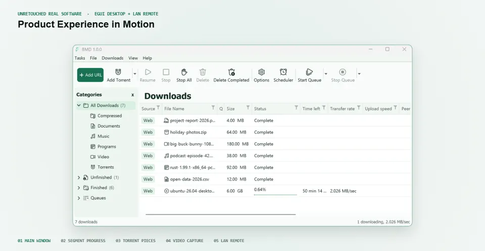
  </picture>
</p>

<details>
<summary><strong>Inspect Individual Unretouched App Screens (Main Window, Progress, Torrent Pieces, Video, Link Grabber)</strong></summary>

<p align="center">
  <picture>
    <source media="(prefers-color-scheme: dark)" srcset="docs/images/main-dark.webp">
    <source media="(prefers-color-scheme: light)" srcset="docs/images/main-light.webp">
    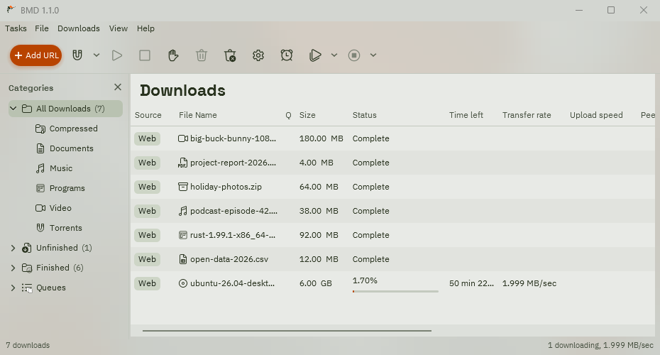
  </picture>
</p>

<table>
  <tr>
    <td width="50%" valign="top">
      <picture>
        <source media="(prefers-color-scheme: dark)" srcset="website/assets/screens/progress-dark.webp">
        <source media="(prefers-color-scheme: light)" srcset="docs/images/progress.webp">
        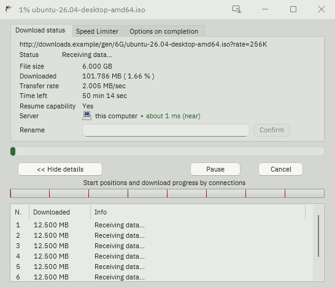
      </picture><br>
      <sub><strong>Segmented HTTP Progress:</strong> 8-lane connection table and live chunk progress.</sub>
    </td>
    <td width="50%" valign="top">
      <picture>
        <source media="(prefers-color-scheme: dark)" srcset="website/assets/screens/torrent-dark.webp">
        <source media="(prefers-color-scheme: light)" srcset="docs/images/progress-torrent-pieces.webp">
        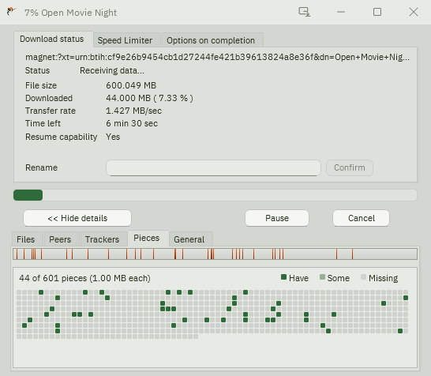
      </picture><br>
      <sub><strong>BitTorrent Piece-Map:</strong> Live <code>Have / Some / Missing</code> grid and peer metrics.</sub>
    </td>
  </tr>
  <tr>
    <td width="50%" valign="top">
      <picture>
        <source media="(prefers-color-scheme: dark)" srcset="website/assets/screens/video-dark.webp">
        <source media="(prefers-color-scheme: light)" srcset="website/assets/screens/video-light.webp">
        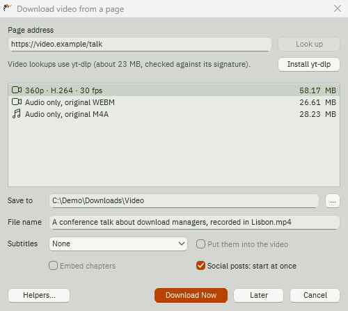
      </picture><br>
      <sub><strong>Video Download Selector:</strong> Format, codec, and <code>Most compatible (H.264 + AAC)</code> presets.</sub>
    </td>
    <td width="50%" valign="top">
      <picture>
        <source media="(prefers-color-scheme: dark)" srcset="docs/images/help/link-grabber-dark.webp">
        <source media="(prefers-color-scheme: light)" srcset="docs/images/grabber.webp">
        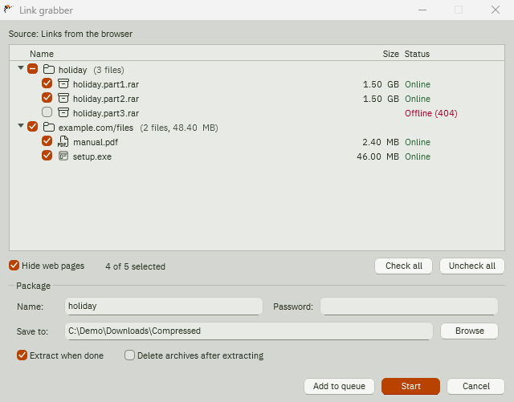
      </picture><br>
      <sub><strong>Link Grabber:</strong> Bulk link capture, category routing, and file selection.</sub>
    </td>
  </tr>
</table>

</details>

---

## 05 · The Engine Beneath

<p align="center">
  <picture>
    <source media="(prefers-color-scheme: dark)" srcset="assets/readme/animations/engine-planner-dark.webp">
    <source media="(prefers-color-scheme: light)" srcset="assets/readme/animations/engine-planner-light.webp">
    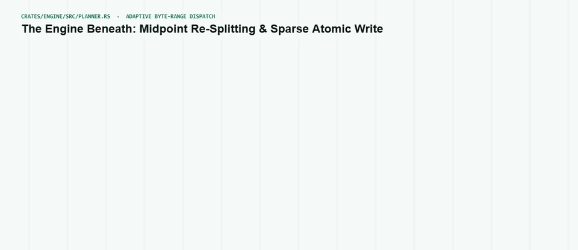
  </picture>
</p>

Inside [`crates/engine`](crates/engine), every HTTP(S) and FTP(S) transfer runs completely decoupled from the UI through a five-stage, crash-safe pipeline:

1. **`probe()` & Site Resolvers (`sites/`):** Validates `Content-Length`, `Accept-Ranges: bytes`, strong `ETag` / `Last-Modified`, and multi-hop redirects (`sites/gdrive.rs`, `mediafire.rs`, `rapidgator.rs`, `archive.rs`, `gofile.rs`, plus expired-link refresh), while `HostLimits` learns per-server connection caps automatically.
2. **Dynamic Midpoint Re-Splitting (`planner.rs`):** Opens parallel HTTP/1.1 connections (`8` by default, `32` standard UI max, up to `128` unlocked) or pooled FTP/FTPS (`REST` + `RETR`) sessions. Whenever a worker finishes its range, the pure `Planner` assigns adjacent free work, preempts stalled unstarted slots, or cuts the **largest remaining unclaimed segment in half** (`4 KiB`-aligned) so faster lanes clear the tail together.
3. **Slow-Worker Drop & Reclaim (`shed_slow`):** After a `2 s` grace window (when not disk-stalled or speed-capped), any connection running below **`1/4` (`SHED_RATIO = 4`)** of the expected active per-connection share with **`> 2 s` remaining** is dropped cleanly and its remaining byte range is split across healthy workers.
4. **Sparse `.bmd.part` + `craft-atomic` Resume:** Files `>= 5 MiB` pre-allocate sparsely (`FSCTL_SET_SPARSE` on NTFS; native sparse on Unix), buffering writes (`HOLD_MAX = 256 MiB`, `WRITE_MAX = 4 MiB`) directly at physical offsets so there is **zero post-download file merge**. `part.sync_data()` completes before `craft_atomic::atomic_write` updates `<dest>.bmd.json`.
5. **Browser-Grade BoringSSL TLS Fallback (`browserlike.rs`):** When strict servers return `412` or reject standard TLS/HTTP2 fingerprints (`Error::BotCheck`), BMD retries via **BoringSSL** (`wreq`) matching your browser's TLS handshake, HTTP/2 settings, header order, and site cookies (without solving CAPTCHAs).

---

## 06 · Performance Measured

<p align="center">
  <picture>
    <source media="(prefers-color-scheme: dark)" srcset="assets/readme/animations/benchmark-telemetry-dark.webp">
    <source media="(prefers-color-scheme: light)" srcset="assets/readme/animations/benchmark-telemetry-light.webp">
    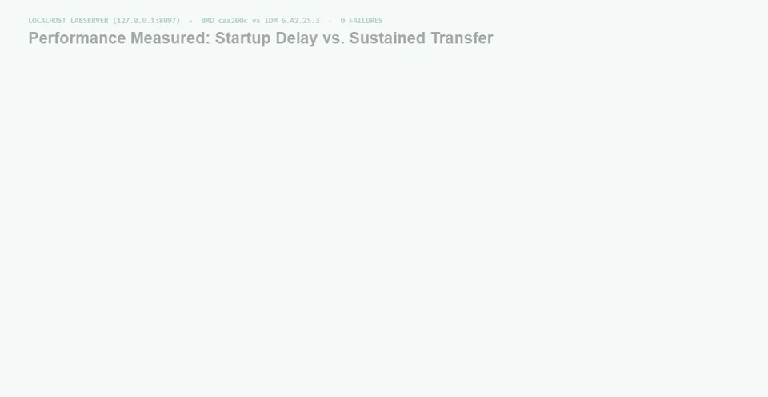
  </picture>
</p>

Recorded **2026-10-29** (`website/bench/results.json`, status `final`, commit `caa200c`) on Windows 11 (`10.0.26200`), Intel Core i5-13400F, `63.8 GB` RAM, local `C:` storage, against [`bmd-labserver`](crates/labserver) (`127.0.0.1:8097`). Both clients ran at **default settings (8 connections)** across alternating runs (**7 runs** per scenario; **15 runs** for `small-256k`; **0 failures**; Mann-Whitney `p <= 0.000583` across all 7 scenarios).

| Scenario | Condition | IDM `6.42.25.3` Median | BMD (`caa200c`) Median | Speedup | Key Engineering Signal |
| :--- | :--- | ---: | ---: | ---: | :--- |
| `fast-1g` | `1 GiB` fast local link | `5,456.38 ms` | `1,009.35 ms` | **5.41×** | `13.7 ms` startup + `438.0 ms` transfer vs `3,075.7 ms` + `1,831.0 ms` |
| `small-256k` | `256 KiB` fast local link (`n=15`) | `3,140.92 ms` | `29.66 ms` | **105.90×** | Eliminates IDM's ~`3.09 s` cold-start overhead |
| `drops-50m` | `50 MiB`, cut every 2nd conn @ 2 MiB (`4 MB/s`) | `5,427.68 ms` | `1,646.52 ms` | **3.30×** | Fast midpoint re-split & connection reclaim |
| `slowconn-32m` | `32 MiB`, 1 in 3 conns at `128 KB/s` | `7,212.96 ms` | `3,432.05 ms` | **2.10×** | Drops crawling lane below `1/4` share (`SHED_RATIO = 4`) |
| `latency-100m` | `100 MiB`, `150 ms` RTT, `4 MB/s` cap | `7,621.91 ms` | `3,843.75 ms` | **1.98×** | Connection pooling & sustained pipeline |
| `capped-100m` | `100 MiB`, `2 MB/s` per connection | `10,234.05 ms` | `6,319.47 ms` | **1.62×** | Near-zero startup + faster tail finish (`14.4 ms` vs `84.1 ms`) |
| `maxconns-50m` | `50 MiB`, max `2` conns (`2 MB/s` each) | `15,864.21 ms` | `12,567.65 ms` | **1.26×** | `HostLimits` uses **2** connections vs IDM's **480** requests |

> **Scope & Honest Tradeoff:** All tests ran over local loopback (`127.0.0.1:8097`) with synthetic fault injection; public WAN packet loss, ISP routing, and internet TLS variance are not modeled. BMD's write buffering (`HOLD_MAX = 256 MiB`) and `egui` GPU pipeline use higher peak working-set memory (**`96.4–106.2 MB`**) than IDM (**`43.2–47.8 MB`**) in exchange for faster throughput and zero post-download merge. Reproduce locally: `cargo run -p bmd-labserver -- --faults "rate=2M"`.

<p align="center">
  <picture>
    <source media="(prefers-color-scheme: dark)" srcset="assets/readme/dividers/divider-slipstream-dark.svg">
    <source media="(prefers-color-scheme: light)" srcset="assets/readme/dividers/divider-slipstream-light.svg">
    
  </picture>
</p>

## 07 · Distributed Intelligence (BitTorrent & uTP)

<p align="center">
  <picture>
    <source media="(prefers-color-scheme: dark)" srcset="assets/readme/animations/bittorrent-swarm-dark.webp">
    <source media="(prefers-color-scheme: light)" srcset="assets/readme/animations/bittorrent-swarm-light.webp">
    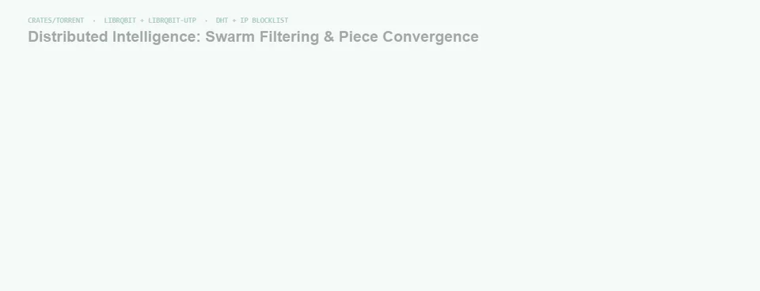
  </picture>
</p>

[`crates/torrent`](crates/torrent) integrates patched `librqbit` and `librqbit-utp` directly into the same desktop queue alongside HTTP downloads—supporting TCP + UDP/`uTP`, DHT, selective magnet file picking, pre-start single-file or folder rename, peer filtering, gzipped IP blocklists, upload speed & share ratio tracking, and a live piece-map grid ([BitTorrent guide](docs/torrents.md)).

---

## 08 · From Browser to Desktop

<p align="center">
  <picture>
    <source media="(prefers-color-scheme: dark)" srcset="assets/readme/animations/browser-to-desktop-dark.webp">
    <source media="(prefers-color-scheme: light)" srcset="assets/readme/animations/browser-to-desktop-light.webp">
    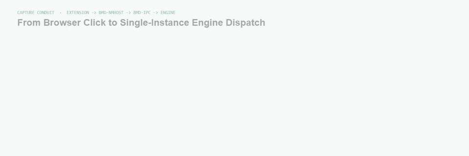
  </picture>
</p>

1. **`extension/` (Chromium MV3, Firefox `140+`, Safari `17+` Exp):** Supports Chrome, Edge, Brave, Opera, Vivaldi, Helium, Comet, Firefox `140+`, Zen, LibreWolf, Floorp, Waterfox, and Safari `17+` (macOS experimental). Passes URL, referrer, User-Agent, site cookies, and optional proxy routing—and adds **Media on this page** plus the draggable **Download video** button.
2. **`bmd-nmhost` (`crates/nmhost`):** Native messaging host (`com.blackmarlindownloader.host`) that applies capture rules and chunks bulk link grabs into `1 MiB` `LinksPart` frames.
3. **`bmd-ipc` (`crates/ipc`):** Token-protected local socket (`127.0.0.1`) that routes jobs to your existing running instance without spawning duplicate windows.
4. **Dispatch (`bmd-app` / `bmd-remote` / `bmd-mcp`):** Queues into desktop or headless mode, while `Alt`-clicking or declining leaves the download cleanly with your browser ([Browser integration](docs/browser-integration.md)).

---

## 09 · Media Without Friction & Remote Control

<table>
  <tr>
    <td width="52%" valign="top">
      <a href="docs/video.md">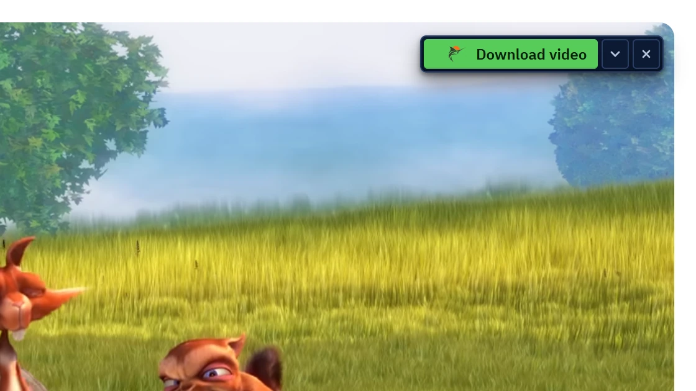</a><br>
      <sub><strong>In-Page Video &amp; Gallery Capture (<code>bmd-tools</code>):</strong> Signature-verified <code>yt-dlp</code>, <code>ffmpeg</code>, and <code>gallery-dl</code> across 1,000+ sites—up to 4K 60fps HDR or a <code>Most compatible (H.264 + AAC)</code> MP4 preset, with chapters, subtitles, playlists, and multi-connection HLS/DASH via <code>bmd-engine</code>.</sub>
    </td>
    <td width="48%" valign="top" align="center">
      <a href="docs/remote-control.md">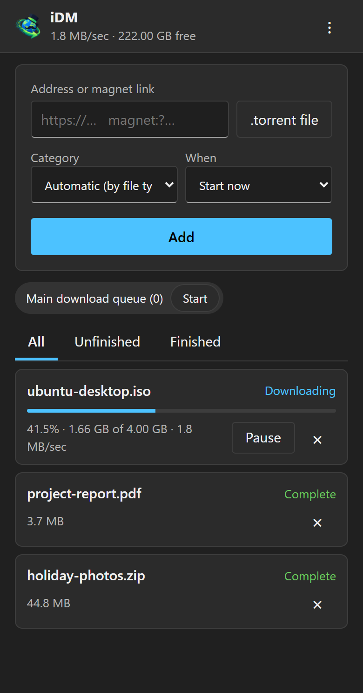</a><br>
      <sub><strong>LAN HTTPS Remote &amp; Automation (<code>bmd-remote</code>, <code>bmd-cli</code>, <code>bmd-mcp</code>):</strong> Run <code>bmd --headless</code> on Linux, NAS, or Docker and pair a phone via QR code + self-signed cert fingerprint on <code>:8463</code>—or script queues with <code>bmd-cli</code> and AI assistants via <code>bmd-mcp</code> (7 MCP tools).</sub>
    </td>
  </tr>
</table>

- **Debrid, Link Grabber & Extraction (`bmd-debrid`, `bmd-cnl`, `bmd-extract`):** Official API resolvers for Real-Debrid, AllDebrid, Premiumize, plus experimental TorBox and Mega-Debrid; local Click'n'Load 2 listener (`127.0.0.1:9666`); keychain-saved archive passwords; in-process `zip`/`tar`/`gz`/`xz` plus external 7-Zip (`7z`/`RAR`) and [HatchZip](https://hatchzip.dev) extract-in-place.

---

## 10 · Engineering Architecture (16 Crates + Extension)

<p align="center">
  <picture>
    <source media="(prefers-color-scheme: dark)" srcset="assets/readme/illustrations/architecture-blueprint-dark.webp">
    <source media="(prefers-color-scheme: light)" srcset="assets/readme/illustrations/architecture-blueprint-light.webp">
    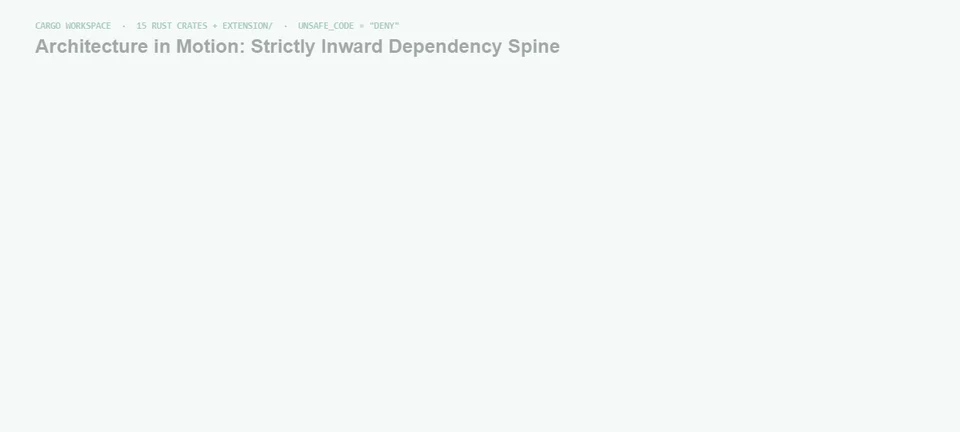
  </picture>
</p>

Dependencies point strictly inward: frontends (`bmd-app`, `bmd-cli`, `bmd-mcp`, `bmd-nmhost`, `bmd-remote`, `bmd-android-bridge`) talk to `bmd-engine` (and desktop frontends over `bmd-ipc`), while `bmd-engine` has **zero** UI dependencies. The workspace enforces `unsafe_code = "deny"` globally, confining `allow(unsafe_code)` to **7** OS/FFI/syscall boundary files (`crates/app/src/win32.rs`, `crates/app/src/unix.rs`, `crates/engine/src/disk.rs`, `crates/engine/src/sparse.rs`, `crates/nmhost/src/win32.rs`, `crates/android-bridge/src/lib.rs`, `crates/android-bridge/src/network.rs`, plus the non-shipped crash example `crates/crash/examples/crashy.rs`). See [`docs/ARCHITECTURE.md`](docs/ARCHITECTURE.md).

<details>
<summary><strong>Complete 16-Crate Workspace Manifest</strong></summary>

| Crate | Path | Binary | Role |
| :--- | :--- | :--- | :--- |
| `bmd-app` | [`crates/app`](crates/app) | `bmd` | `egui` desktop UI (D3D12/OpenGL/Vulkan/Metal), categories, queues, Scheduler, 10 theme choices, tray, `--headless` |
| `bmd-engine` | [`crates/engine`](crates/engine) | — | Core segmented HTTP(S)/FTP(S) engine, midpoint planner, BoringSSL TLS fallback, sparse `.bmd.part` + atomic `.bmd.json` |
| `bmd-cli` | [`crates/cli`](crates/cli) | `bmd-cli` | Headless `get`/`resume`/`video-get` and full queue/automation CLI (`--json`) |
| `bmd-mcp` | [`crates/mcp`](crates/mcp) | `bmd-mcp` | Stdio Model Context Protocol server (`rmcp`) exposing 7 queue & download tools |
| `bmd-nmhost` | [`crates/nmhost`](crates/nmhost) | `bmd-nmhost` | Browser native messaging host (`com.blackmarlindownloader.host`) with `1 MiB` `LinksPart` framing |
| `bmd-ipc` | [`crates/ipc`](crates/ipc) | — | Token-protected `127.0.0.1` single-instance channel, IDM switches (`/d /p /f /a /n /s`), shared capture rules |
| `bmd-remote` | [`crates/remote`](crates/remote) | — | LAN HTTPS server (`:8463`), QR pairing, device tokens, and mobile web UI |
| `bmd-torrent` | [`crates/torrent`](crates/torrent) | — | BitTorrent & magnet engine (`librqbit` + `librqbit-utp`), piece-map, DHT, IP blocklists |
| `bmd-tools` | [`crates/tools`](crates/tools) | — | Pinned & signature-verified `yt-dlp`, `ffmpeg`, `gallery-dl`, parallel HLS/DASH relay, updater |
| `bmd-debrid` | [`crates/debrid`](crates/debrid) | — | Real-Debrid, AllDebrid, Premiumize, TorBox (exp), Mega-Debrid (exp) API resolvers |
| `bmd-cnl` | [`crates/cnl`](crates/cnl) | — | Click'n'Load 2 local listener (`127.0.0.1:9666`) feeding Link grabber |
| `bmd-extract` | [`crates/extract`](crates/extract) | — | In-process `zip`/`tar`/`gz`/`xz`; external 7-Zip (`7z`/`RAR`) & HatchZip extract-in-place |
| `bmd-geo` | [`crates/geo`](crates/geo) | — | Offline DB-IP IP-to-Country Lite lookup + 250-country flag atlas |
| `bmd-crash` | [`crates/crash`](crates/crash) | — | Out-of-process crash/freeze watchdog, minidumps, and symbolicated stack traces |
| `bmd-labserver` | [`crates/labserver`](crates/labserver) | `labserver` | HTTP Range + FTP/FTPS fault-injection test and benchmark server |
| `bmd-android-bridge` | [`crates/android-bridge`](crates/android-bridge) | — | Native Android JNI and admitted-network adapter bridging Kotlin UI to `bmd-engine` |

</details>

---

## 11 · Built for the World (86 Languages & Full RTL)

<p align="center">
  <picture>
    <source media="(prefers-color-scheme: dark)" srcset="assets/readme/features/global-rtl-dark.webp">
    <source media="(prefers-color-scheme: light)" srcset="assets/readme/features/global-rtl-light.webp">
    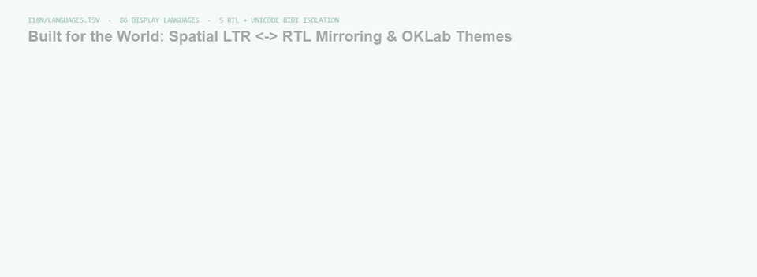
  </picture>
</p>

BMD speaks every Windows 11 display language—**86 languages** in [`i18n/languages.tsv`](i18n/languages.tsv)—with full right-to-left UI mirroring for **Arabic (`ar`), Persian (`fa`), Hebrew (`he`), Urdu (`ur`), and Uyghur (`ug`)**, plus Unicode bidi isolation so URLs, file paths, and numbers always remain readable ([Languages guide](docs/languages.md) · [Themes guide](docs/themes.md)).

<details>
<summary><strong>Inspect Arabic RTL Desktop Window &amp; First-Start Language Picker</strong></summary>

<table>
  <tr>
    <td width="64%" valign="middle">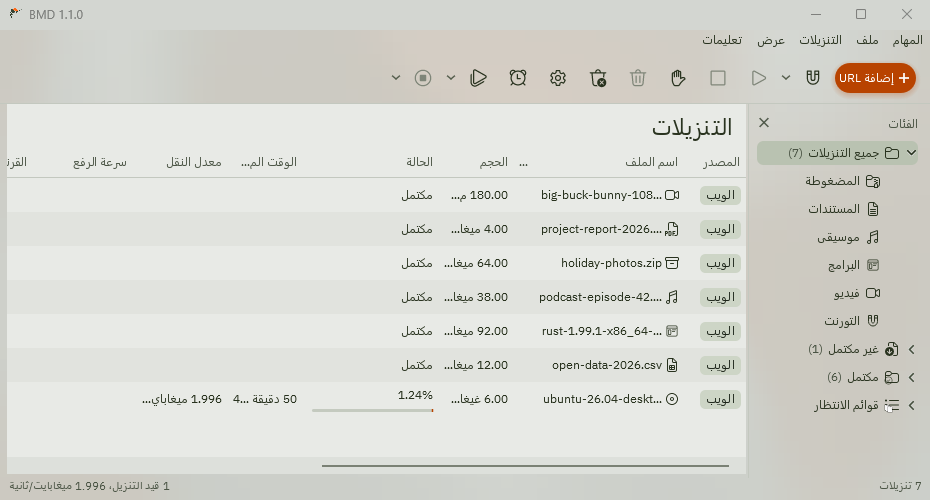</td>
    <td width="36%" align="center" valign="middle">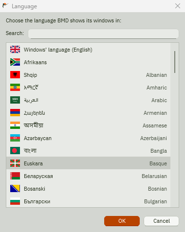</td>
  </tr>
</table>

</details>

---

## 12 · Freedom by Design

<p align="center">
  <picture>
    <source media="(prefers-color-scheme: dark)" srcset="assets/readme/features/privacy-freedom-dark.webp">
    <source media="(prefers-color-scheme: light)" srcset="assets/readme/features/privacy-freedom-light.webp">
    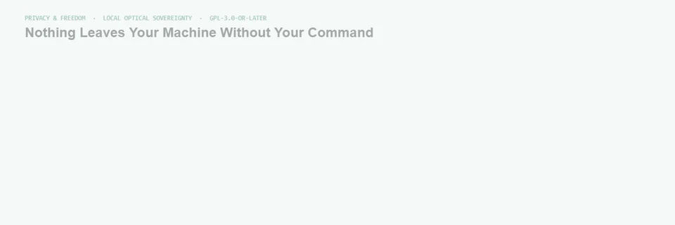
  </picture>
</p>

- **`GPL-3.0-or-later` Forever:** Free to use, inspect, modify, and redistribute—no trial countdowns, no nag dialogs, no account walls.
- **Zero Telemetry & Offline Geo:** No analytics phone-home, no cloud relay for LAN remote, and `bmd-geo` IP-to-country lookups run 100% offline from bundled DB-IP Lite data.
- **Zero Credential Persistence in Resume Files:** Cookies and `Authorization` headers are never written into `.bmd.json` resume state.

<p align="center">
  <picture>
    <source media="(prefers-color-scheme: dark)" srcset="assets/readme/dividers/divider-slipstream-dark.svg">
    <source media="(prefers-color-scheme: light)" srcset="assets/readme/dividers/divider-slipstream-light.svg">
    
  </picture>
</p>

## 13 · Living Adoption

<p align="center">
  <picture>
    <source media="(prefers-color-scheme: dark)" srcset="assets/readme/analytics/living-adoption-dark.webp">
    <source media="(prefers-color-scheme: light)" srcset="assets/readme/analytics/living-adoption-light.webp">
    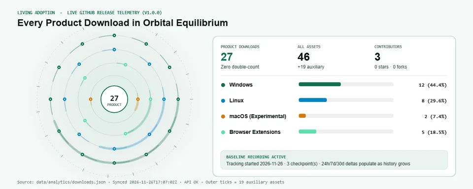
  </picture>
</p>

Refreshed every **6 hours** via [`.github/workflows/readme-analytics.yml`](.github/workflows/readme-analytics.yml) from the GitHub Releases & Repository API into [`data/analytics/downloads.json`](data/analytics/downloads.json). Product & extension downloads (installers, portable archives, Linux packages, experimental macOS builds, and browser extensions) are counted strictly separately from auxiliary assets (debug symbols, `.zsync` delta metadata, checksums, and geo data) with zero double-counting. Snapshot tracking started **`2026-11-26`**; `24h` / `7d` / `30d` deltas appear only once real snapshots span those windows.

<details>
<summary><strong>Live CI Telemetry Sheet &amp; Plain-Text Audit Table</strong></summary>

<p align="center">
  <picture>
    <source media="(prefers-color-scheme: dark)" srcset="assets/readme/analytics/telemetry-dashboard-dark.svg">
    <source media="(prefers-color-scheme: light)" srcset="assets/readme/analytics/telemetry-dashboard-light.svg">
    
  </picture>
</p>

<!-- BMD:ANALYTICS-TEXT:START -->
| Metric | Value |
| :--- | :--- |
| **Product & Extension Downloads** | **59** (excludes 32 auxiliary files; zero double-counting) |
| **All Release Assets Total** (incl. symbols, `.zsync`, checksums, geo) | 91 |
| **Latest Release** | `v1.1.0` (22 product downloads · 2026-11-27) |
| **Growth Windows** | 24h: +32 · 7d: pending · 30d: pending |
| **Repository Pulse** | 0 stars · 0 forks · 4 contributors |
| **Tracking Started** | `2026-11-26 16:20 UTC` |
| **Last Synced** | `2026-11-28 01:17 UTC` · `api_status`: `ok (live GitHub API)` |

| Platform Bucket | Category | Downloads | Share (Product) | Share (All Assets) |
| :--- | :--- | ---: | ---: | ---: |
| Windows | Product | 29 | 49.1% | 31.9% |
| Linux | Product | 16 | 27.1% | 17.6% |
| macOS (Experimental) | Product | 4 | 6.8% | 4.4% |
| Browser Extensions | Product | 10 | 16.9% | 11.0% |
| Other / Auxiliary | Auxiliary | 32 | n/a | 35.2% |
<!-- BMD:ANALYTICS-TEXT:END -->

</details>

---

## 14 · Release Evolution & Roadmap

| Release | Date | Milestones |
| :--- | :--- | :--- |
| **`0.1.0`** | `2026-10-30` | Initial clean-room Rust engine: up to 32 connections, FTP/FTPS, queues & Scheduler, 86 languages, BitTorrent (`librqbit`), `yt-dlp` capture, `bmd-cli`. |
| **`0.5.0` → `0.5.2`** | `2026-11-08` – `2026-11-09` | Theme engine (TOML/JSON, Base16, `pywal`), `--headless` & LAN HTTPS remote, browser extensions, `gallery-dl` & playlists, selective torrent files. |
| **`1.0.0`** | `2026-11-19` | First release as **Black Marlin Downloader (`BMD`)**: Win ARM64 & x86, Linux ARM64, H.264+AAC preset, `bmd-mcp`, `bmd-cli` queue control, BoringSSL browser TLS & parallel HLS/DASH, Click'n'Load 2, TorBox/Mega-Debrid, Sigstore provenance. |
| **`[Unreleased]`** | Active | Embedded **IBM Plex Sans**, **IBM Plex Mono**, and **Space Grotesk** typography across desktop, extension, and remote UI. |

Next up in [`ROADMAP.md`](ROADMAP.md): Orca screen-reader & Flatpak native-messaging checks on Linux, native Wayland popup placement, promoting the Vulkan GPU renderer, Developer ID signing for Safari/macOS, and expanded benchmarks ([`CHANGELOG.md`](CHANGELOG.md)).

---

<a id="download-center"></a>

## 15 · Download Center

[Latest installers and checksums](https://github.com/DecoyINDIA/BMD/releases/latest).

<p align="center">
  <picture>
    <source media="(prefers-color-scheme: dark)" srcset="assets/readme/features/download-platforms-dark.webp">
    <source media="(prefers-color-scheme: light)" srcset="assets/readme/features/download-platforms-light.webp">
    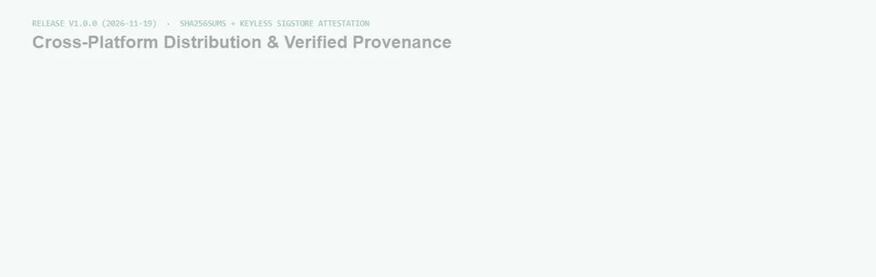
  </picture>
</p>

Published **2026-11-27** · [Release Notes (`v1.1.0`)](https://github.com/DecoyINDIA/BMD/releases/tag/v1.1.0) · [All Releases](https://github.com/DecoyINDIA/BMD/releases)

### Windows (Windows 10 / 11)
Also via WinGet: `winget install DecoyINDIA.BMD`

| Architecture | Installer (Recommended) | Portable Zip (`data/` beside exe) | Raw Zip (`%APPDATA%\bmd`) |
| :--- | :--- | :--- | :--- |
| **x64** (Intel / AMD) | [`BMD-1.1.0-setup.exe`](https://github.com/DecoyINDIA/BMD/releases/download/v1.1.0/BMD-1.1.0-setup.exe) (`19.5 MiB`) | [`BMD-1.1.0-portable.zip`](https://github.com/DecoyINDIA/BMD/releases/download/v1.1.0/BMD-1.1.0-portable.zip) (`24.5 MiB`) | [`BMD-1.1.0-x64.zip`](https://github.com/DecoyINDIA/BMD/releases/download/v1.1.0/BMD-1.1.0-x64.zip) (`24.5 MiB`) |
| **ARM64** (Snapdragon) | [`BMD-1.1.0-setup-arm64.exe`](https://github.com/DecoyINDIA/BMD/releases/download/v1.1.0/BMD-1.1.0-setup-arm64.exe) (`18.3 MiB`) | [`BMD-1.1.0-portable-arm64.zip`](https://github.com/DecoyINDIA/BMD/releases/download/v1.1.0/BMD-1.1.0-portable-arm64.zip) (`23.1 MiB`) | [`BMD-1.1.0-arm64.zip`](https://github.com/DecoyINDIA/BMD/releases/download/v1.1.0/BMD-1.1.0-arm64.zip) (`23.1 MiB`) |
| **x86** (32-bit Win 10) | [`BMD-1.1.0-setup-x86.exe`](https://github.com/DecoyINDIA/BMD/releases/download/v1.1.0/BMD-1.1.0-setup-x86.exe) (`18.9 MiB`) | [`BMD-1.1.0-portable-x86.zip`](https://github.com/DecoyINDIA/BMD/releases/download/v1.1.0/BMD-1.1.0-portable-x86.zip) (`23.1 MiB`) | [`BMD-1.1.0-x86.zip`](https://github.com/DecoyINDIA/BMD/releases/download/v1.1.0/BMD-1.1.0-x86.zip) (`23.1 MiB`) |

### Linux (`glibc >= 2.35`) & Docker / Headless
Tested on Ubuntu 24.04, Debian 12, and Fedora (GNOME, KDE Plasma, Xfce, Cinnamon on X11 & Wayland/XWayland).

| Architecture | Debian / Ubuntu (`.deb`) | Fedora / RHEL (`.rpm`) | Universal (`.AppImage`) | Plain Archive (`.tar.gz`) |
| :--- | :--- | :--- | :--- | :--- |
| **`x86_64`** | [`BMD-1.1.0-linux-x86_64.deb`](https://github.com/DecoyINDIA/BMD/releases/download/v1.1.0/BMD-1.1.0-linux-x86_64.deb) (`20.2 MiB`) | [`BMD-1.1.0-linux-x86_64.rpm`](https://github.com/DecoyINDIA/BMD/releases/download/v1.1.0/BMD-1.1.0-linux-x86_64.rpm) (`24.6 MiB`) | [`BMD-1.1.0-linux-x86_64.AppImage`](https://github.com/DecoyINDIA/BMD/releases/download/v1.1.0/BMD-1.1.0-linux-x86_64.AppImage) (`23.7 MiB`) | [`BMD-1.1.0-linux-x86_64.tar.gz`](https://github.com/DecoyINDIA/BMD/releases/download/v1.1.0/BMD-1.1.0-linux-x86_64.tar.gz) (`24.6 MiB`) |
| **`arm64`** | [`BMD-1.1.0-linux-arm64.deb`](https://github.com/DecoyINDIA/BMD/releases/download/v1.1.0/BMD-1.1.0-linux-arm64.deb) (`19.4 MiB`) | [`BMD-1.1.0-linux-arm64.rpm`](https://github.com/DecoyINDIA/BMD/releases/download/v1.1.0/BMD-1.1.0-linux-arm64.rpm) (`23.3 MiB`) | [`BMD-1.1.0-linux-arm64.AppImage`](https://github.com/DecoyINDIA/BMD/releases/download/v1.1.0/BMD-1.1.0-linux-arm64.AppImage) (`22.6 MiB`) | [`BMD-1.1.0-linux-arm64.tar.gz`](https://github.com/DecoyINDIA/BMD/releases/download/v1.1.0/BMD-1.1.0-linux-arm64.tar.gz) (`23.3 MiB`) |

- **Docker / Unraid (`--headless`):** `ghcr.io/decoyindia/bmd:latest` (exposes `:8463` for LAN HTTPS remote control) · [`docker/compose.yml`](docker/compose.yml) · [`docker/unraid.xml`](docker/unraid.xml) · [Server guide](docs/server.md).

### macOS (Experimental) & Browser Extensions

| Target | Package | Size | Notes |
| :--- | :--- | ---: | :--- |
| **macOS Apple Silicon (`arm64`)** | [`BMD-1.1.0-macos-arm64-experimental.dmg`](https://github.com/DecoyINDIA/BMD/releases/download/v1.1.0/BMD-1.1.0-macos-arm64-experimental.dmg) | `17.4 MiB` | Experimental, unnotarized; right-click → **Open** ([On a Mac](docs/getting-started.md#on-a-mac)) |
| **macOS Intel (`x86_64`)** | [`BMD-1.1.0-macos-x86_64-experimental.dmg`](https://github.com/DecoyINDIA/BMD/releases/download/v1.1.0/BMD-1.1.0-macos-x86_64-experimental.dmg) | `19.8 MiB` | Experimental, unnotarized; bundles Safari `17+` extension |
| **Chromium MV3 (Unpacked)** | [`BMD-1.1.0-extension-chromium.zip`](https://github.com/DecoyINDIA/BMD/releases/download/v1.1.0/BMD-1.1.0-extension-chromium.zip) | `445.0 KiB` | Chrome, Edge, Brave, Opera, Vivaldi, Helium, Comet |
| **Chrome Web Store Bundle** | [`BMD-1.1.0-chrome-web-store.zip`](https://github.com/DecoyINDIA/BMD/releases/download/v1.1.0/BMD-1.1.0-chrome-web-store.zip) | `443.7 KiB` | Store-packaged Chromium MV3 bundle |
| **Firefox (`140+`) Add-on** | [`BMD-1.1.0-extension-firefox.xpi`](https://github.com/DecoyINDIA/BMD/releases/download/v1.1.0/BMD-1.1.0-extension-firefox.xpi) | `446.2 KiB` | Unsigned `.xpi` for `about:debugging` / Nightly / unbranded forks |

### Verification & Provenance
- **SHA-256 Manifest:** [`SHA256SUMS.txt`](https://github.com/DecoyINDIA/BMD/releases/download/v1.1.0/SHA256SUMS.txt) (`3.3 KiB`)
- **Keyless Sigstore Provenance:** `gh attestation verify <downloaded-file> --repo DecoyINDIA/BMD`

---

## 16 · Docs, Community & Building from Source

| Guide & Reference | Scope |
| :--- | :--- |
| [**User Guide Index**](docs/README.md) | [Getting Started](docs/getting-started.md) · [Browser Integration](docs/browser-integration.md) · [Command Line](docs/command-line.md) · [MCP AI Assistants](docs/ai-assistants.md) |
| [**Architecture & Design**](docs/ARCHITECTURE.md) | Crate boundaries, engine planner, OKLab theme system ([`PRODUCT.md`](PRODUCT.md) · [`DESIGN.md`](DESIGN.md)) |
| [**Contributing**](CONTRIBUTING.md) | Clean-room rules, local test harness, translation workflow, `fuzz/` targets |
| [**Security Policy**](SECURITY.md) | Private advisories, `bmd-nmhost`/`bmd-ipc` trust boundaries, helper signatures |
| [**Attribution & License**](ATTRIBUTION.md) | Icons, DB-IP Lite dataset, SIL OFL fonts, and [`GPL-3.0-or-later`](LICENSE) |

Requires **Rust `1.98+`** (`stable` toolchain via [`rust-toolchain.toml`](rust-toolchain.toml), edition `2024`), **CMake**, **LLVM (`libclang`)**, and **NASM** on Windows (for BoringSSL):

```sh
cargo build
cargo run -p bmd-app
```

Workspace verification suite:

```sh
cargo fmt --all --check
cargo clippy --workspace --all-targets -- -D warnings
cargo test --workspace
python tools/i18n/extract.py
node tools/extension/test.mjs
```

### Native Android

The Android source is in [`android/`](android/): a Kotlin/Jetpack Compose interface with the Rust download engine behind JNI. It requires Android 8.0 (API 26) or later and supports direct HTTP and HTTPS file links, explicit Paste or Android sharing, pause/resume, optional expected SHA-256 verification, and saving through MediaStore or a folder selected in Android's picker. Transfers, Files and Settings work without a Black Marlin account.

Android has its own scope: desktop browser extensions, torrents, video extraction, FTP, scheduled queues and account sync are not part of this application. A saved file and a transfer-history entry have separate removal controls; a failed save can reuse the retained download.

Read the [build, test and release instructions](docs/android/BUILD_AND_RELEASE.md), [screen and flow design](docs/android/DESIGN.md), and [Android privacy description](docs/android/PRIVACY.md). Build and device results must be checked for the exact revision being distributed; this source tree does not imply an existing Google Play release.


---

<!-- CHAPTER 17: BEYOND THE HORIZON -->
<p align="center">
  <picture>
    <source media="(prefers-color-scheme: dark)" srcset="assets/readme/branding/closing-horizon-dark.webp">
    <source media="(prefers-color-scheme: light)" srcset="assets/readme/branding/closing-horizon-light.webp">
    
  </picture>
</p>
