# Getting started

[← Back to docs index](README.md)

BMD runs on Windows 10 and Windows 11 (x64, ARM64 and 32-bit), and on 64-bit Linux (x86-64 and
ARM64): see [On Linux](#on-linux). Builds for macOS are new and still experimental: see
[On a Mac](#on-a-mac).

## Choose a download

Published BMD builds will appear on the [Releases](https://github.com/DecoyINDIA/BMD/releases) page. Until builds are available, follow the [source build instructions](../CONTRIBUTING.md#getting-set-up). Windows builds use these file names:

| File | What it is |
|---|---|
| `BMD-<version>-setup.exe` | The installer. Pick this one unless you have a reason not to. It can set up browser integration and open `.torrent` files and magnet links with BMD. |
| `BMD-<version>-portable.zip` | A portable copy. The download list and settings stay in a `data` folder next to the program, and nothing is written to the registry. Browser integration needs the installer. See [Portable mode](portable.md). |
| `BMD-<version>-x64.zip` | The same programs without an installer. It keeps its data in `%APPDATA%\bmd`, like an installed copy. |

These three are for 64-bit Windows on an Intel or AMD processor (x64), the usual PC. From the
version after 0.5.2, each comes for two more kinds of PC too, with the processor in its name:

| Files | For |
|---|---|
| `...-setup-arm64.exe`, `...-portable-arm64.zip`, `...-arm64.zip` | **Windows on ARM** (PCs with a Snapdragon or another ARM processor). On Windows 11 the x64 files run there too, translated by Windows, more slowly. The ARM64 setup installed over the x64 one replaces it; your list and settings stay, as they are kept in your profile, not with the program. |
| `...-setup-x86.exe`, `...-portable-x86.zip`, `...-x86.zip` | **32-bit Windows 10.** Not sure which you have? **Settings → System → About → System type** says it. BMD can't download ffmpeg for you there (none is built for 32-bit Windows that BMD can check): to get the best video qualities, choose an ffmpeg of your own in **Helpers...** ([Video](video.md#yt-dlp-and-ffmpeg)). |

**Help → Check for updates** updates each copy to the files for its own processor.

### With WinGet

The upstream BMD is available through [WinGet](https://learn.microsoft.com/windows/package-manager/winget/). Use GitHub Releases for BMD. These commands apply to the upstream package:

```
winget install DecoyINDIA.BMD
winget upgrade DecoyINDIA.BMD
```

### On Linux

BMD runs on 64-bit Linux with a desktop session. It is tested on Ubuntu 24.04, Debian 12 and
Fedora, with GNOME, KDE Plasma, Xfce and Cinnamon, on X11 and in Wayland sessions. Pick one
of these files (up to version 0.2.4, their names end in `-experimental`, as in
`...-linux-x86_64-experimental.deb`). From the version after 0.5.2, each also comes for 64-bit
ARM computers, with `arm64` in place of `x86_64` (`...-linux-arm64.deb`); they are built and
tested on GitHub's ARM machines. On ARM, BMD doesn't download gallery-dl itself (its author
builds none for it): install it with your system's packages or pip.

| File | What it is |
|---|---|
| `...-linux-x86_64.deb` | For Ubuntu, Debian, Mint and Pop!_OS: `sudo apt install ./<file>.deb`. It brings the libraries BMD needs. |
| `...-linux-x86_64.rpm` | For Fedora, openSUSE and RHEL: `sudo dnf install ./<file>.rpm`. It brings the libraries BMD needs. |
| `...-linux-x86_64.AppImage` | Runs on most distributions: make it executable (`chmod +x`) and run it. It updates itself in place (**Help → Check for updates**). |
| `...-linux-x86_64.tar.gz` | The plain programs, for any distribution. |

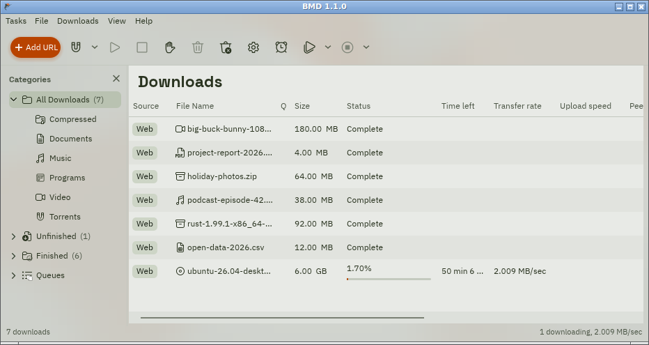
*BMD in an X11 session on Linux.*

Browser integration is set up by BMD itself at each start (the browsers installed then are found); add the extension as in [Browser integration](browser-integration.md). Firefox installed as a Snap (Ubuntu's) reaches BMD once you allow it; other Snap and Flatpak browsers can't (see [Flatpak and Snap browsers](browser-help.md#linux-sandbox)). The tray icon, Dark Mode support and Launch on startup work on GNOME (Ubuntu's), KDE Plasma, Xfce and Cinnamon.

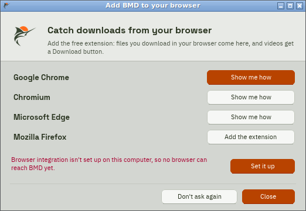
*Use Set it up if browser integration has not been configured.*

In a Wayland session the windows go through XWayland or Wayland (below). Not there yet on Linux: screen
readers (Orca) don't read BMD's windows; browsers installed as a Flatpak can't reach BMD (Firefox
from Flathub may, through the desktop as the Snap does, but that isn't checked yet); and **View →
Draw with → Vulkan** is a choice, OpenGL stays the default.

In a Wayland session, BMD chooses its windows' system as it starts, the same way however it was started (its menu entry, the browser's helper, the session's autostart). Its windows run through XWayland where X11 programs look right: only X11 lets BMD open its menus and drop-down lists right under what you clicked (on Wayland they open where the compositor puts new windows, often the middle of the screen) and hide its window in the notification area. That is GNOME and KDE Plasma, which tell X11 programs the screen's scale, and any desktop whose screens aren't scaled. On a scaled screen where nothing tells X11 programs the scale (Hyprland, labwc, sway and other wlroots compositors), the compositor would scale BMD's windows up, blurry, so BMD uses Wayland's own windows there. **View → Window system** picks **X11 (XWayland)** or **Wayland** instead, from the next start, for every way BMD starts (**Automatic** goes back to BMD's choice); `BMD_WAYLAND=1` or `BMD_WAYLAND=0` decides for one start. If the system lacks a library X11 windows need (such as libxkbcommon-x11, which the .deb and .rpm bring but the AppImage and the tar.gz can't), BMD opens on Wayland instead; with no window system it can use, it names what's missing and the command that installs it.

The windows are the ones described in this help, with BMD's built-in fonts (IBM Plex and Space Grotesk), the desktop's file icons and title
bars:

<!-- pictures -->

- 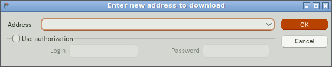
  *Add URL.*
- 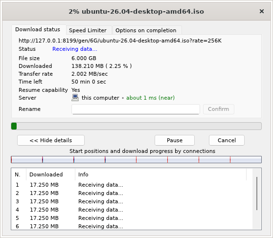
  *A download's progress.*
- 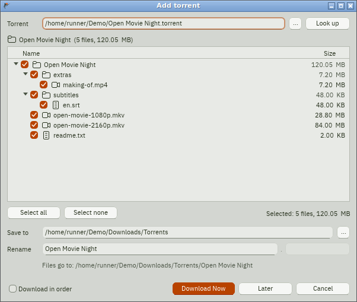
  *Add torrent.*
- 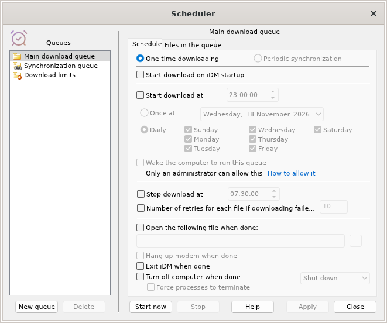
  *The Scheduler.*
- 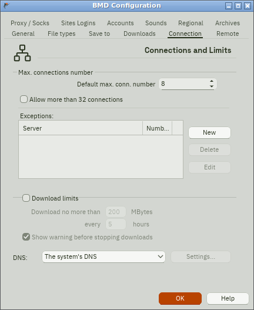
  *Options.*

#### Uninstall on Linux {#uninstall-linux}

`sudo apt remove bmd` (or `sudo dnf remove bmd`) removes the
programs, and the small files that tell your browsers where BMD's helper is: the .deb and .rpm
install those for everyone (in `/etc` and `/usr/lib`), for Chrome, Chromium, Edge, Brave, Vivaldi,
Helium and Firefox (the Snap too), so BMD doesn't write them in your home folder. For the AppImage
or the tar.gz, delete the file or the folder.

What BMD keeps in your home folder stays, as with any package: your list and settings
(`~/.local/share/bmd`), the AppImage's and the tar.gz's browser files, and
those of the browsers that read them only there (Opera, Helium, Thorium, and Firefox's forks:
Zen, LibreWolf, Floorp, Waterfox). A package can't remove those: it never touches
home folders. Without BMD they lead nowhere, so the extension says it can't reach BMD. To remove
them as well, run this as each user who used BMD, **before** uninstalling:

```sh
bmd-nmhost --unregister
```

(From the AppImage: `~/.local/share/bmd/browser-host/bmd-nmhost --unregister`.)
Already uninstalled? This removes the same files:

```sh
find ~/.mozilla ~/.librewolf ~/.config -name com.blackmarlindownloader.host.json -delete 2>/dev/null
```

### On a Mac

The macOS builds are fresh and still experimental: we haven't tried them on a Mac ourselves yet,
so you'd be among the first. Please
[tell us how it went](https://github.com/DecoyINDIA/BMD/issues/new/choose), good or bad.

| File | What it is |
|---|---|
| `...-macos-arm64-experimental.dmg` | For a Mac with Apple Silicon (M1 or later: **Apple menu → About This Mac** shows a *Chip*). Open it and drag BMD to Applications. macOS asks before its first start, because the app isn't notarized by Apple: right-click it and choose **Open** (on macOS 15 and later: **System Settings → Privacy & Security → Open Anyway**). |
| `...-macos-x86_64-experimental.dmg` | The same, for a Mac with an Intel processor (About This Mac shows a *Processor*). |

Browser integration is set up by BMD itself at each start (the browsers installed then are found); add the extension as in [Browser integration](browser-integration.md).

## Install with the setup

1. Run `BMD-<version>-setup.exe`.
2. Choose the language. Windows' display language is already selected. The setup offers every language BMD has, and BMD starts in the one you pick.
3. Choose whether to install for you only or for everyone on the computer. For you only needs no administrator rights and goes to `%LOCALAPPDATA%\Programs\BMD`. For everyone goes to `Program Files`.
4. Pick what the setup should do:
   - **Set up browser integration (Chrome, Edge, Brave, Firefox)**
   - **Open .torrent files and magnet links with BMD**
   - **Start BMD when Windows starts**
   - **Create a desktop shortcut** (off unless you tick it)
5. Click **Install**, then **Finish** to start BMD.

If BMD is already running, the setup asks it to save and close first. To update, use **Help → Check for updates → Update now**, or run the setup of the new version (when available); your list and settings stay.

Browser integration needs one more step in each browser. Firefox needs BMD's add-on to be published on addons.mozilla.org first, which has not happened yet. For Chrome, Edge, Brave, Opera, Vivaldi and Helium, [load the bundled extension manually](browser-integration.md#chrome-edge-brave-opera-and-vivaldi).

### Uninstall

Uninstall BMD from Windows **Settings → Apps**. The uninstaller asks whether to delete your download list and settings too. Your downloaded files are never touched.

## Use a zip copy

1. Unzip the file to a folder you can write to (not straight into `Program Files`).
2. Run `bmd.exe`.

The zips hold the same programs as the setup: the app, `bmd-cli.exe` (downloads from the command line; see [Command line and automation](command-line.md)) and the `extension` folder.

## First start and the language

- **Installed with the setup:** BMD starts in the language you chose in the setup.
- **Otherwise:** BMD shows the list of languages, each with its flag and its own name. Pick yours.

You can change it at any time in **View → Language**. More in [Languages](languages.md).

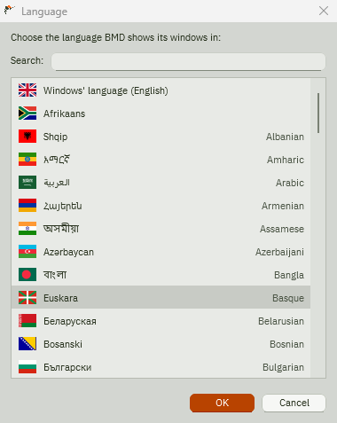
*Pick your language. View → Language changes it later.*

## The video helpers

Next, BMD offers its two free video helpers: **yt-dlp**, which finds the video on a page, and
**ffmpeg**, which joins its picture and sound. Click **Yes, download them (recommended)** and they
download in the background, about 100 MB, once. **Not now** leaves them for later: the video
window offers them when you first need them. More in [Videos](video.md).

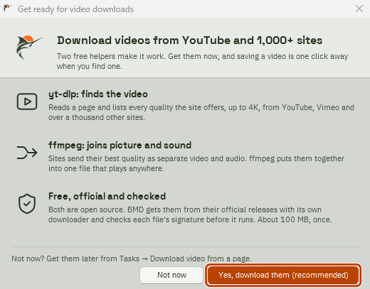
*Yes downloads both helpers in the background, once.*

## The main window

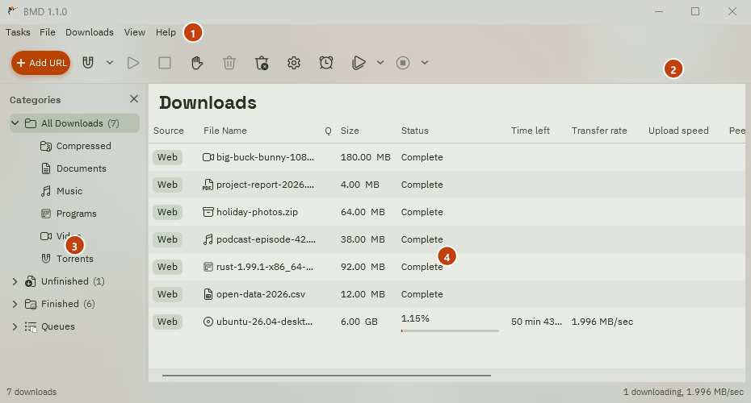
*1 the menu bar, 2 the toolbar, 3 the categories, 4 the download list.*

From top to bottom:

- **Menu bar.**
  - **Tasks** — add downloads, torrents, magnet links, batch downloads and videos from a page; **Torrent settings**; **Link grabber**; **RSS feeds**; show the drop target; import and export the list; exit.
  - **File** — the selected download: **Stop Download**, **Remove**, **Download Now**, **Redownload**.
  - **Downloads** — **Pause All**, **Stop All**, **Delete All Completed**, **Find**, the **Scheduler**, queues, the **Speed Limiter** and **Options**.
  - **View** — show or hide the categories, sort the list (**Arrange files**), **Appearance** (Light, Dark or Follow system), **Interface size** (every window larger, 100 % to 200 %; **Ctrl +**, **Ctrl −** and **Ctrl 0** too), **Text** (Windows: smooth or classic letters), **Draw with** (OpenGL, or Direct3D on Windows, Vulkan on Linux, Metal on macOS) and **Language**.
  - **Help** — help pages and tutorials (on the website, in your language when it has it), **Keyboard shortcuts**, **Report a problem**, **Check for updates**, **About**, **Tell a friend** and **Support BMD** (the project on GitHub).
- **Toolbar.** **Add URL**, **Add Torrent**, **Resume**, **Stop**, **Stop All**, **Delete**, **Delete Completed**, **Options**, **Scheduler**, **Start Queue**, **Stop Queue**. The small arrow next to **Add Torrent**, **Start Queue** and **Stop Queue** opens more choices.
- **Categories** (left). Choose what the list shows: **All Downloads**, **Unfinished**, **Finished** and **Queues**, each with its categories. Drag the gap between the pane and the list to make it wider.
- **Download list** (right). One row per download. See [The download list](download-list.md).

## Light and dark

BMD has two looks, light and dark, both in its brand colours: Kombu Green, Brushed Aluminium and a
Signal Orange accent. Choose under **View → Appearance**:

- **Light**: always light: brushed aluminium surfaces, kombu green text and orange actions.
- **Dark**: always dark: kombu green surfaces, aluminium text and orange actions.
- **Follow system**: light or dark as Windows (or your desktop's light/dark preference on Linux
  and macOS) is set, changing when it changes. A desktop that reports no preference shows light.

The change applies at once, nothing to restart.

Behind the menu bar, toolbar and categories, slow clouds in the same colours drift (the download
list stays solid). They hold still while BMD's window isn't the active one, and when Windows'
**Animation effects** are off. **View → Appearance → Animated background** turns them off.

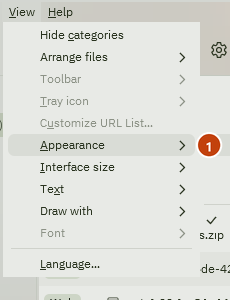
*1 Appearance: Light, Dark, or Follow system.*

## The tray icon

Closing the main window doesn't quit BMD. It hides in the notification area, and downloads, queues and schedules carry on. To make closing quit (a portable copy's folder can then be deleted), untick **Options → General → Keep running when closing the window**. If there is no icon for BMD at all — not in the notification area, nor behind the ^ hidden icons — the window minimizes to the taskbar instead, so downloads continue and there is a way back. An icon behind ^ can be clicked to bring the window back, and starting BMD again always does. On macOS the window closes into the Dock, as Mac apps' windows do: click BMD's icon in the Dock (or in the menu bar) to bring it back, and quit with **Cmd+Q** or **BMD → Quit**.

On Linux this needs a tray, which most desktops have (KDE Plasma, Xfce, Cinnamon, Ubuntu's GNOME or GNOME with the AppIndicator extension, waybar's tray). On a desktop without one (some tiling window managers), closing the window quits BMD, since there would be nowhere to bring it back from.

- Click the tray icon to bring the window back.
- Right-click it for **Add new download**, **Add batch download**, **Downloads in progress**, **Speed Limiter**, **Scheduler**, the main download queue, **Options** and **Exit**.
- **Downloads in progress** lists the running downloads. Choose one to see its progress window.

Minimize hides the main window there too, while **Minimize to the notification area** is on in **Options → General**. It is on by default; where the tray has no icon, Minimize sends the window to the taskbar instead.

A download's progress window can go there as well, with its Minimize or with its **Hide to the notification area** button: a short dash with an arrow down to the corner.

On Windows that button is in the window's title bar, left of Minimize, and in the title bar's menu (Alt+Space). On Linux and macOS it's at the end of the tab row.

To bring the window back, choose it in **Downloads in progress**, or double-click the download in the list.

To quit, choose **Tasks → Exit** or **Exit** in the tray menu.

## Where BMD keeps its data

The download list and settings are in `%APPDATA%\bmd` (`downloads.json`); on Linux in `~/.local/share/bmd`, on a Mac in `~/Library/Application Support/bmd`. A portable copy keeps them in its `data` folder instead. Downloaded files go to your **Downloads** folder, sorted into a folder per category; you can change that in **Options → Save to**.

## Next steps

- [Download your first file →](guide-first-download.md)
- [Send browser downloads to BMD →](browser-integration.md)
- [Learn the download list →](download-list.md)
