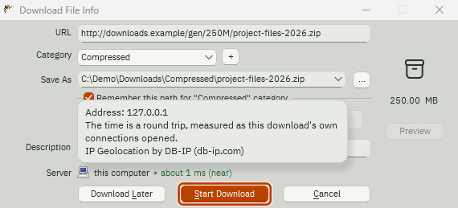
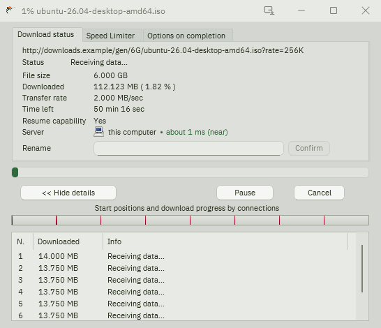
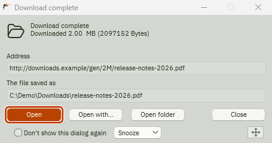
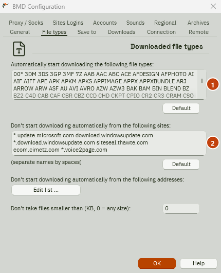

# Tutorial: catch downloads from your browser

[← Back to docs index](README.md)

Set up the extension once, and every download link you click in Firefox, Chrome, Edge, Brave, Opera, Vivaldi or Helium goes to BMD.

## Before you start

On Windows, BMD must be installed with the setup, with **Set up browser integration (Chrome, Edge, Brave, Firefox)** ticked. It is ticked by default. If you're not sure, run the setup again. A portable copy can't do this. On Linux and macOS, start BMD once: it sets browser integration up itself.

BMD's **Add BMD to your browser** window opens at each start until a browser's extension has reached BMD. **Add the extension** opens the Firefox add-on page or opens a local setup guide in the selected Chromium browser and copies the bundled extension's folder path. **Show me how** opens this guide when the bundled setup files are unavailable.

Once it is set up, a download link goes like this:

<!-- steps -->

1. 
   *Click a download link in the browser: Download File Info opens in BMD.*
2. 
   *Start Download: the progress window shows it coming in.*
3. 
   *Download complete: Open the file, or Open folder.*

## In Firefox

BMD's Firefox add-on is not on addons.mozilla.org yet, and Firefox installs only add-ons Mozilla has signed. Use a Chromium-based browser below for now; this guide will link the listing once it exists.

Then, in any browser where the extension is on: go to a web page and click a download link, for example a ZIP or an EXE: BMD opens **Download File Info**. Click **Start Download**.

## In Chrome, Edge, Brave, Comet, Opera, Vivaldi or Helium

Load the bundled extension manually.

1. Open your browser's extensions page from its menu or type its address. In Comet, use `chrome://extensions`.
2. Turn on **Developer mode**.
3. Click **Load unpacked**.
4. Paste the folder path copied by BMD or choose the `extension\chromium` folder inside BMD's folder. If you downloaded the Chromium extension ZIP, unzip it and choose the folder containing `manifest.json`.
5. **BMD** appears. Make sure it is turned on.
6. Go to a web page and click a download link, for example a ZIP or an EXE.
7. BMD opens **Download File Info** instead of the browser downloading the file. Click **Start Download**.

You don't need to start BMD first: if it isn't running, it starts by itself.

## Choose what BMD takes

- **Which file types:** **Options → File types → Automatically start downloading the following file types**. Add or remove types, separated by spaces.
- **Sites to leave alone:** **Options → File types → Don't start downloading automatically from the following sites**. Add the site's name, for example `example.com`: it covers `www.example.com` and the site's other subdomains, and the files its pages link to on another server.
- **One browser only:** **Options → General → Capture downloads from the following browsers**. Untick the ones BMD should leave alone.

*1 the file types BMD takes, 2 the sites it leaves to the browser.*

Everything BMD doesn't take stays with the browser.

## Download a link the browser would open

Links to a PDF or a video file, which the browser would open itself, go to BMD too when their type is listed. To leave one to the browser, hold **Alt** while clicking it (Firefox opens it; Chrome and Edge download it themselves). Any other link: right-click it and choose **Download with BMD**, which takes any type.

## Next steps

- [Browser integration in detail (Firefox, private windows, what is sent) →](browser-integration.md)
- [If the browser doesn't hand downloads over →](troubleshooting.md#the-browser-doesnt-send-downloads-to-idm)
- [Download overnight →](guide-download-overnight.md)
